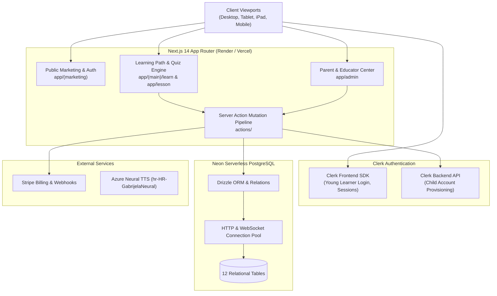
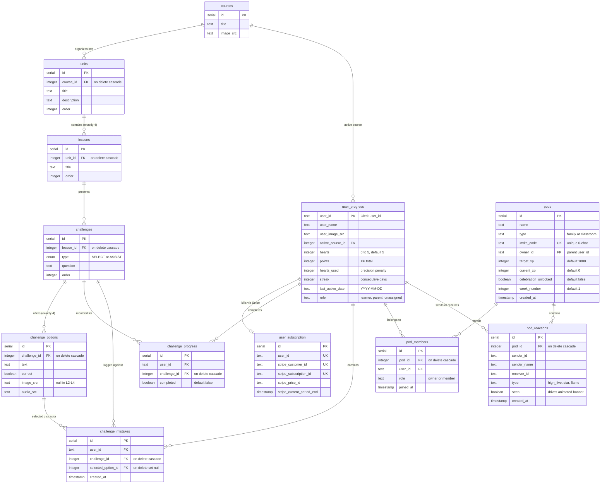
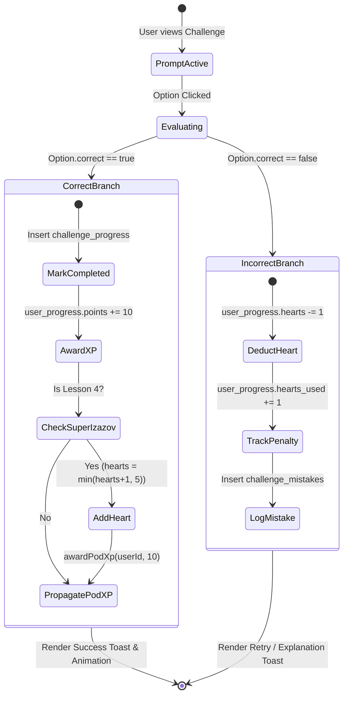
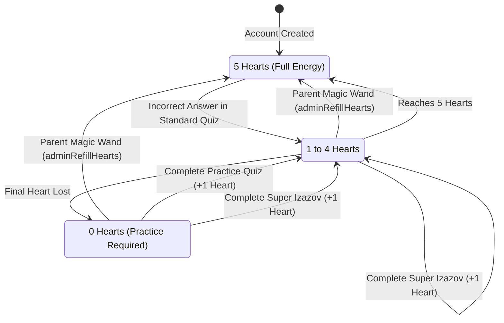
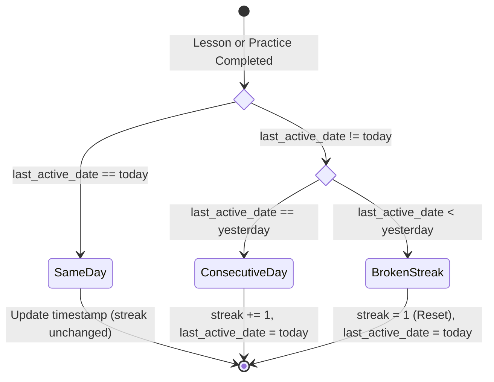
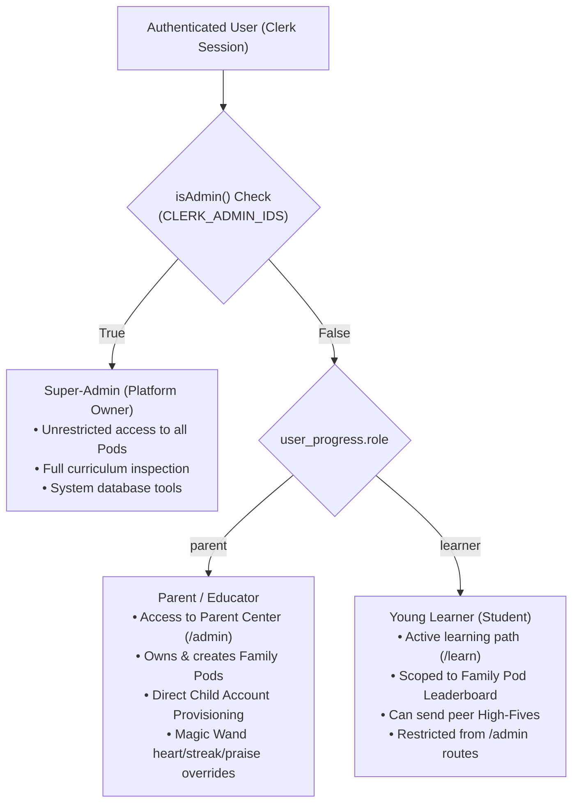

# ⚙️ CroLingo System Architecture, Data Models & State Machine

> **Document Status:** 🏛️ **CORE ENGINEERING & DATA SPECIFICATION (DOC 2)**  
> **Repository:** `AdminPhil/2lingo`  
> **Source of Truth:** System tech stack, dual-domain Mermaid ERD, Drizzle schema, operational state machines, Clerk RBAC, and server action contracts.  
> **Local Dev & Setup:** See [`docs/1. DEVELOPMENT_AND_SETUP.md`](./1.%20DEVELOPMENT_AND_SETUP.md) for environment configuration.  
> **Pedagogical Spec:** See [`docs/3. CURRICULUM_STANDARDS.md`](./3.%20CURRICULUM_STANDARDS.md) for curriculum rules.  
> **Child Privacy:** See [`docs/7. SECURITY_AND_COPPA.md`](./7.%20SECURITY_AND_COPPA.md) for COPPA/GDPR-K boundaries.  
> **Deployment:** See [`docs/9. DEPLOYMENT_AND_DEVOPS.md`](./9.%20DEPLOYMENT_AND_DEVOPS.md) for Render and Neon pooling.

---

## 1. System Overview & Tech Stack

CroLingo is a full-stack, cloud-native web application built on **Next.js 14**, **Neon Serverless PostgreSQL**, and **Clerk Authentication**:



---

## 2. Dual-Domain Entity-Relationship Architecture

CroLingo's database separates cleanly into two distinct operational domains:
1. **The Curriculum Domain:** Static, declarative educational content (Courses, Units, Lessons, Challenges, and Options).
2. **The User, Gamification & Social Domain:** Dynamic state tracking individual progress, family pods, peer reactions, and subscriptions.



---

## 3. Table-by-Table Schema Dictionary

### Domain 1: Curriculum Content (Declarative & Static)

#### 1. `courses`
The top-level language registry. Currently contains Course `1` (*Croatian / Hrvatski*).
- `id`: `serial` primary key.
- `title`: `text`, not null. Course display name (e.g. `"Croatian"`).
- `imageSrc`: `text`, not null. Path to flag asset (e.g. `"/hr.svg"`).

#### 2. `units`
Curriculum units organized across the 4 Worlds (Zagreb, Coast, Plitvice, King's Landing).
- `id`: `serial` primary key.
- `courseId`: `integer` foreign key referencing `courses.id` (`onDelete: "cascade"`).
- `title`: `text`, not null (e.g. `"Unit 1"`, `"Unit 16"`).
- `description`: `text`, not null. Subtitle and pedagogical theme (e.g. `"U školi i učionici (At School & Learning)"`).
- `order`: `integer`, not null. Sequence order on the learning map.

#### 3. `lessons`
Individual lesson nodes along the path. Enforces the strict "3 + 1" Unit Arc (exactly 4 lessons per unit).
- `id`: `serial` primary key.
- `unitId`: `integer` foreign key referencing `units.id` (`onDelete: "cascade"`).
- `title`: `text`, not null (e.g. `"Pozdravi"`, `"Super Izazov"`).
- `order`: `integer`, not null (`1` = Discovery, `2` = Practice, `3` = Sentences, `4` = Boss Quest).

#### 4. `challenges`
Interactive quiz prompts presented to learners.
- `id`: `serial` primary key.
- `lessonId`: `integer` foreign key referencing `lessons.id` (`onDelete: "cascade"`).
- `type`: `pgEnum("type", ["SELECT", "ASSIST"])`.
  - `SELECT`: Image cards or compact choice tiles in a 2×2 or 4-column grid.
  - `ASSIST`: Full-width text list options.
- `question`: `text`, not null. The challenge prompt (e.g. `"Which one of these is 'Goodbye'?"`).
- `order`: `integer`, not null. Sequence within the lesson quiz.

#### 5. `challenge_options`
The selectable multiple-choice answers. Enforces the 4-Option Grid Invariant.
- `id`: `serial` primary key.
- `challengeId`: `integer` foreign key referencing `challenges.id` (`onDelete: "cascade"`).
- `text`: `text`, not null. The Croatian option text.
- `correct`: `boolean`, not null. Exactly one option per challenge is `true`.
- `imageSrc`: `text`, nullable. Present in Lesson 1; **strictly `null` in Lessons 2, 3, and 4**.
- `audioSrc`: `text`, nullable. Path to synthesized neural audio (e.g. `"/audio/hr/dovidenja.mp3"`).

---

### Domain 2: User Progress & Social Hierarchy (Dynamic & Mutable)

#### 6. `user_progress`
Core profile and gamification record per Clerk user.
- `userId`: `text` primary key (Clerk user ID).
- `userName`: `text`, default `"User"`. Display name on leaderboards.
- `userImageSrc`: `text`, default `"/mascot.png"`. Circular avatar image.
- `activeCourseId`: `integer` foreign key referencing `courses.id`.
- `hearts`: `integer`, default `5` (range 0–5). Current practice energy.
- `points`: `integer`, default `0`. Cumulative learner XP.
- `heartsUsed`: `integer`, default `0`. Cumulative mistakes metric measuring precision.
- `streak`: `integer`, default `0`. Consecutive calendar days of active practice.
- `lastActiveDate`: `text`, nullable (`YYYY-MM-DD`). Timestamp for streak calculations.
- `role`: `text`, default `"learner"`. Access control role: `"learner"`, `"parent"`, or `"unassigned"`.

#### 7. `challenge_progress`
Records whether a user has successfully mastered a specific challenge.
- `id`: `serial` primary key.
- `userId`: `text`, not null.
- `challengeId`: `integer` foreign key referencing `challenges.id` (`onDelete: "cascade"`).
- `completed`: `boolean`, default `false`.

#### 8. `challenge_mistakes`
Audit log of errors for the Parent Center Tricky Words analytics.
- `id`: `serial` primary key.
- `userId`: `text`, not null.
- `challengeId`: `integer` foreign key referencing `challenges.id` (`onDelete: "cascade"`).
- `selectedOptionId`: `integer` foreign key referencing `challenge_options.id` (`onDelete: "set null"`).
- `createdAt`: `timestamp`, default `now()`.

#### 9. `pods`
Family circles and collaborative learning groups.
- `id`: `serial` primary key.
- `name`: `text`, not null. Pod name (e.g. `"The Horvat Family"`).
- `type`: `text`, default `"family"`.
- `inviteCode`: `text` unique, not null. Clean 6-character alphanumeric code (e.g. `"HORVAT"`).
- `ownerId`: `text`, not null. Parent/Educator Clerk user ID who manages the pod.
- `targetXp`: `integer`, default `1000`. Collective weekly target for celebration confetti.
- `currentXp`: `integer`, default `0`. Current pooled XP accumulated this week.
- `celebrationUnlocked`: `boolean`, default `false`. Triggers celebratory confetti when `true`.
- `weekNumber`: `integer`, default `1`.
- `createdAt`: `timestamp`, default `now()`.

#### 10. `pod_members`
Membership join table establishing user enrollment and authorization.
- `id`: `serial` primary key.
- `podId`: `integer` foreign key referencing `pods.id` (`onDelete: "cascade"`).
- `userId`: `text`, not null.
- `role`: `text`, default `"member"` (`"owner"` for creator, `"member"` for children).
- `joinedAt`: `timestamp`, default `now()`.

#### 11. `pod_reactions`
Low-stress peer high-fives and cheer notifications.
- `id`: `serial` primary key.
- `podId`: `integer` foreign key referencing `pods.id` (`onDelete: "cascade"`).
- `senderId`: `text`, not null.
- `senderName`: `text`, not null.
- `receiverId`: `text`, not null.
- `type`: `text`, default `"high_five"`.
- `seen`: `boolean`, default `false`. Drives `<CheerBanner />` display on `/learn`.
- `createdAt`: `timestamp`, default `now()`.

#### 12. `user_subscription`
Stripe subscription state for Pro tier memberships.
- `id`: `serial` primary key.
- `userId`: `text` unique, not null.
- `stripeCustomerId`: `text` unique, not null.
- `stripeSubscriptionId`: `text` unique, not null.
- `stripePriceId`: `text`, not null.
- `stripeCurrentPeriodEnd`: `timestamp`, not null.

---

## 4. Core Operational State Machines

### 4.1 Challenge Submission & Scoring Pipeline



---

### 4.2 Heart Energy & Recharge State Machine



---

### 4.3 Daily Streak Habit Loop State Machine



---

## 5. User Identity & Role Hierarchy (RBAC)

CroLingo enforces a three-tier user hierarchy built on Clerk authentication:



### 5.1 Child Account Provisioning Architecture
Young children often lack email addresses or phone numbers. CroLingo solves this via the **Direct Child Account Provisioning Engine** ([`actions/child-account.ts`](file:///c:/Users/phili/Documents/phils_repo/actions/child-account.ts)):
1. The parent enters a simple username (e.g., `luka_dalmacija`) and password in the Parent Center.
2. The server action calls the **Clerk Backend REST API** using `CLERK_SECRET_KEY` to create a managed user account with zero email verification requirement.
3. The server action initializes `user_progress` with `role: "learner"` and automatically inserts a `pod_members` record binding the child to the parent's active pod.
4. The child can immediately log in on an iPad or tablet using the username and password.

---

## 6. Learning Pods Authorization & Scoping Mechanics

### 6.1 Relational Privacy Scoping
CroLingo enforces child privacy by scoping leaderboards to **authorized pod members only** ([`db/queries.ts`](file:///c:/Users/phili/Documents/phils_repo/db/queries.ts) $\rightarrow$ `getTopTenUsers`):
```sql
SELECT up.* FROM user_progress up
JOIN pod_members pm ON up.user_id = pm.user_id
WHERE pm.pod_id = :activePodId AND up.role = 'learner'
ORDER BY up.points DESC LIMIT 10;
```
- Children never see strangers, public accounts, or global internet users.
- Super-admin and developer test accounts are filtered out of student leaderboards by default.

### 6.2 Multi-Pod XP Propagation
When a child completes a challenge (`upsertChallengeProgress`), practices to earn a heart (`practiceToEarnHeart`), or receives parental praise (`adminAwardPraiseXp`):
1. Their individual `user_progress.points` increments.
2. The action triggers `awardPodXp(userId, xp)`.
3. The database updates `pods.current_xp = current_xp + xp` across **every pod the learner belongs to**.
4. If `current_xp >= target_xp`, `celebration_unlocked` is set to `true`, triggering celebratory confetti and team reward modals.

---

## 7. Server Action Mutation Pipelines

All data mutations in CroLingo execute through strictly typed Next.js Server Actions:

| Server Action File | Primary Actions | State & Side-Effects |
| :--- | :--- | :--- |
| **`actions/challenge-progress.ts`** | `upsertChallengeProgress()` | Records challenge completion, awards +10 XP, restores **+1 Heart on Super Izazov**, propagates XP to active pods, logs mistakes on failure. |
| **`actions/user-progress.ts`** | `reduceHearts()`<br/>`refillHearts()`<br/>`practiceToEarnHeart()` | Increments `hearts_used`, deducts heart on quiz error, resets hearts to 5, awards +1 Heart and +10 XP upon completing 3-question review quiz. |
| **`actions/pod.ts`** | `joinPodByCode()`<br/>`createPod()`<br/>`awardPodXp()` | Validates 6-character invite code, enrolls learner, recalculates weekly celebration meter. |
| **`actions/admin-overrides.ts`** | `adminRefillHearts()`<br/>`adminProtectStreak()`<br/>`adminAwardPraiseXp()` | Parent Magic Wand overrides: restores child hearts to 5, grants streak grace day, rewards offline Croatian conversation with +25/+50 XP. |
| **`actions/child-account.ts`** | `createChildAccount()` | Calls Clerk Backend API to provision email-less child logins and enrolls them in parent's pod. |
| **`actions/cheer.ts`** | `sendCheer()`<br/>`markCheerAsSeen()` | Delivers peer high-fives with daily rate limits; claiming awards +5 XP to recipient and active pods. |

---

## 8. Drizzle ORM Migration Protocol & Sequence Synchronization

### 8.1 Applying Schema Updates (`npm run db:push`)
CroLingo uses **Drizzle Kit Push** to synchronize TypeScript schema definitions with Neon PostgreSQL:
```bash
# Push schema updates non-destructively to Neon
npm run db:push
```
- Drizzle introspects the remote database, compares tables, and executes required `CREATE TABLE`, `ALTER TABLE`, or `ADD COLUMN` statements.
- Never drops tables or columns unless explicitly requested.

### 8.2 Sequence Synchronization Protocol
Neon PostgreSQL uses `serial` columns powered by underlying Postgres sequences (`units_id_seq`, `lessons_id_seq`, etc.). When running bulk inserts or restoration scripts, the sequence pointer can become desynchronized, causing `duplicate key value violates unique constraint` errors.

Whenever a seed script or migration completes, execute this SQL synchronization block:
```sql
SELECT setval('courses_id_seq', COALESCE((SELECT MAX(id) FROM courses), 1));
SELECT setval('units_id_seq', COALESCE((SELECT MAX(id) FROM units), 1));
SELECT setval('lessons_id_seq', COALESCE((SELECT MAX(id) FROM lessons), 1));
SELECT setval('challenges_id_seq', COALESCE((SELECT MAX(id) FROM challenges), 1));
SELECT setval('challenge_options_id_seq', COALESCE((SELECT MAX(id) FROM challenge_options), 1));
SELECT setval('pods_id_seq', COALESCE((SELECT MAX(id) FROM pods), 1));
SELECT setval('pod_members_id_seq', COALESCE((SELECT MAX(id) FROM pod_members), 1));
SELECT setval('pod_reactions_id_seq', COALESCE((SELECT MAX(id) FROM pod_reactions), 1));
SELECT setval('challenge_progress_id_seq', COALESCE((SELECT MAX(id) FROM challenge_progress), 1));
SELECT setval('challenge_mistakes_id_seq', COALESCE((SELECT MAX(id) FROM challenge_mistakes), 1));
```

---

## 9. Strict Zero Data Loss Invariant

> **MANDATORY POLICY FOR ALL DEVELOPERS AND AGENTS:**  
> Real children and families rely on CroLingo daily. Production accounts (`Adriana`, `Silvia`, `Vanessa`, `Zvon`) have earned thousands of XP, unlocked milestones, and built multi-day streaks. Under no circumstances may a curriculum update, database seed, or migration drop or truncate learner data.

### Seed Script Isolation Rule
All database seed scripts ([`scripts/seed.ts`](file:///c:/Users/phili/Documents/phils_repo/scripts/seed.ts), `scripts/prod.ts`) must isolate curriculum tables:
```ts
// ✅ PERMITTED: Truncating curriculum content tables only
await db.delete(challengeOptions);
await db.delete(challenges);
await db.delete(lessons);
await db.delete(units);

// ❌ STRICTLY FORBIDDEN: NEVER touch user progress or pods
// await db.delete(userProgress);     <-- NEVER!
// await db.delete(challengeProgress);<-- NEVER!
// await db.delete(pods);             <-- NEVER!
```

### Dynamic Coordinate Lookup
Neon Postgres auto-increment IDs shift across re-seeds. Scripts that refine or update specific challenges must **never** hardcode database IDs. Always lookup challenges using their natural hierarchical coordinates:
$$\text{Target Challenge} = \text{Query where } (\text{unit.order} = U \text{ and } \text{lesson.order} = L \text{ and } \text{challenge.order} = C)$$
This ensures that running a refinement script always modifies the exact intended challenge regardless of underlying sequence shifts.

---

## 10. Asset Architecture & Deployment Pipeline

- **Audio Assets (`public/audio/hr/*.mp3`):** Synthesized using Azure Cognitive Services Neural Croatian TTS (`hr-HR-GabrijelaNeural` at `-5%` rate). Automated via `scripts/generate_croatian_audio.py`.
- **Mascot Artwork (`public/mascot.png`, `public/pasko-hero.jpg`):** High-resolution digital illustrations featuring Paško the Dalmatian pup, Croatian folk gingerbread hearts (*licitarsko srce*), coastal ferries (*trajekt*), and checkerboard (*šahovnica*) tokens.
- **Render Deployment Pipeline:**
  - Tracked on Render Web Service via `render.yaml`.
  - Deploys automatically triggered via `scripts/trigger-render-deploy.js` executing asynchronously with zero polling.
