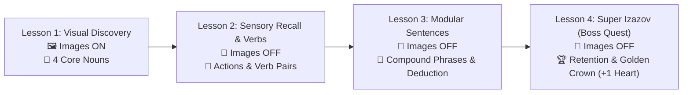
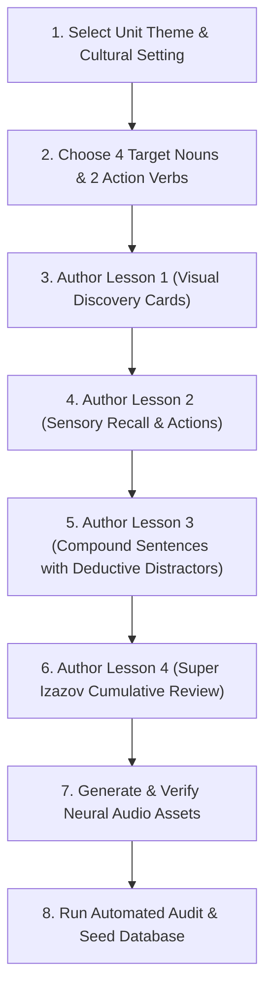

# 📖 CroLingo Lesson Planning & Curriculum Authoring Playbook

> **Document Status:** 🏛️ **CURRICULUM AUTHORING SPECIFICATION (DOC 4)**  
> **Repository:** `AdminPhil/2lingo`  
> **Audience:** Curriculum Authors, Native Croatian Educators, Linguists, and Engineers  
> **Specification Contract:** For the formal invariant rules enforced by automated CI/CD audits, see [`docs/3. CURRICULUM_STANDARDS.md`](./3.%20CURRICULUM_STANDARDS.md).  
> **Design & Theming:** For regional visual themes and World progression, see [`docs/5. DESIGN_SYSTEM.md`](./5.%20DESIGN_SYSTEM.md).

---

## 1. Pedagogical Philosophy & Audience

### 1.1 The Learner Profile
CroLingo is engineered specifically for **diaspora children, heritage learners, and young families** (ages 5–14+). 
- **The Emotional Hurdle:** Heritage learners often experience *linguistic anxiety*—feeling shy or embarrassed when speaking around fluent relatives (*Baka, Dida, rođaci*).
- **The Core Pedagogical Mandate:** Every lesson must be **low-friction, anxiety-free, and high in positive dopamine**. We never test an unlearned word without visual or deductive scaffolding. Guessing should feel like an exciting detective mystery ("Aha!"), never a frustrating blind coin toss.

---

## 2. The Pedagogical Flow of a Unit: The "3 + 1" Arc

Every unit in CroLingo guides the learner through a structured 4-lesson progression designed to move them from zero-knowledge visual discovery to long-term auditory retention:



> [!NOTE]
> For the strict database schema constraints, challenge counts, and progressive fading specifications of this arc, refer to the formal contract in [3. CURRICULUM_STANDARDS.md § 1](./3.%20CURRICULUM_STANDARDS.md#1-the-3--1-unit-arc-specification).

---

## 3. Step-by-Step Unit Authoring Workflow

Follow these 8 steps when authoring any new unit (e.g., Units 21 through 120):



### Step 1: Select Unit Theme & Cultural Setting
- Pick a concrete, child-friendly topic (e.g., *At the Bakery*, *Summer at the Coast*, *Animals on the Farm*, *Sports Day*).
- Align with the **Regional World Journey** defined in [`docs/5. DESIGN_SYSTEM.md`](./5.%20DESIGN_SYSTEM.md) (e.g., World 1: Zagreb, World 2: Adriatic Coast, World 3: Plitvice & Slavonia, World 4: King's Landing & Dubrovnik).

### Step 2: Choose 4 Target Nouns & 2 Action Verbs
Every unit introduces:
- **4 Core Nouns:** Concrete, tangible items easy to illustrate (e.g., *Burek*, *Kruh*, *Jabuka*, *Sir*).
- **2 Paired Verbs or Descriptive Adjectives:** (e.g., *Kupiti* / To buy, *Jesti* / To eat, or *Toplo* / Warm, *Svježe* / Fresh).

### Step 3: Author Lesson 1 (Visual Discovery)
- Introduce each of the 4 nouns individually with `imageSrc` attached.
- Prompt: `"Which of these is 'Bread'?"` → Choices: *Kruh* (with `/bread.svg`), *Jabuka* (with `/apple.svg`), etc.
- **Rule:** Lesson 1 is the **only** lesson where `imageSrc` is permitted ([3. CURRICULUM_STANDARDS.md § 3](./3.%20CURRICULUM_STANDARDS.md#3-progressive-scaffolding-fading-invariant)).

### Step 4: Author Lesson 2 (Sensory Recall & Actions)
- Remove all images (`imageSrc = null`).
- Test the 4 nouns purely by reading and listening.
- Introduce the unit's 2 core action verbs using **Deductive Elimination** (see Section 4).

### Step 5: Author Lesson 3 (Modular Compound Sentences)
- Construct simple, reusable 3-word sentences:
  $$\text{Subject (Mastered Noun)} + \text{Verb (New Action)} + \text{Object (Target Noun)}$$
  *Example:* `"Mama kupuje kruh"` (Mom buys bread) or `"Deda jede burek"` (Grandpa eats burek).
- **Enforce Deductive Distractors:** When testing a full sentence or new verb, the 3 distractors must be constructed from familiar vocabulary so the child can deduce the meaning without panic.

### Step 6: Author Lesson 4 (Super Izazov — Boss Quest)
- Mix all 4 nouns, the 2 verbs, and the compound sentences in a cumulative review.
- Challenge difficulty escalates from word recognition to auditory phrase translation.
- Finishing Lesson 4 unlocks the **Golden Trophy Crown** on the unit map and awards **+1 Heart** ([CR-029](./CHANGELOG.md)).

### Step 7: Generate & Verify Neural Audio Assets
- 100% of challenge options and prompt phrases must have high-quality audio synthesized using Azure Cognitive Services:
  - **Voice:** `hr-HR-GabrijelaNeural`
  - **Rate:** `-5%` (slightly measured for young learners)
  - **Output Path:** `public/audio/hr/<slug>.mp3`
- Run the generation script: `python scripts/generate_croatian_audio.py`.

### Step 8: Run Pre-Flight Automated Audit
Before committing to the database, run the automated curriculum rules auditor:
```bash
npx tsx --env-file=.env.local scripts/audit-curriculum-rules.ts
```
The script validates zero missing audio, zero broken SVGs, zero illegal images on Lessons 2–4, and proper 4-option symmetry.

---

## 4. Authoring Deductive Elimination Distractors

Deductive Elimination is CroLingo's primary cognitive scaffolding technique. Rather than guessing randomly, the child eliminates known words to discover the new word.

> [!IMPORTANT]
> The formal mathematical constraints for deductive distractors (target isolation, mastered pool selection, and semantic divergence) are codified in [3. CURRICULUM_STANDARDS.md § 2](./3.%20CURRICULUM_STANDARDS.md#2-deductive-elimination-aha-discovery-rule-specification).

### Authoring Tips:
1. **Pull From Diverse Categories:** When authoring distractors for a new verb (e.g., *Plivati* / To swim), select one animal (*Pas*), one food (*Jabuka*), and one building (*Kuća*). Spanning distinct categories ensures the child has zero hesitation ruling them out.
2. **Chain New Words Sequentially:** Once a word has been deduced in Challenge 2 of Lesson 2, it can safely serve as a known distractor in Challenge 3!

---

## 5. Standard Lesson Plan Authoring Template

Copy this template when creating any new Unit before writing seed code:

```markdown
# Unit [Number]: [Croatian Title] ([English Title])
- **Regional World:** [e.g. World 2: Coastal Explorer • Adriatic Sea & Islands]
- **Target Vocabulary:**
  - Noun 1: [Croatian] ([English]) -> Asset: `/slug.svg`
  - Noun 2: [Croatian] ([English]) -> Asset: `/slug.svg`
  - Noun 3: [Croatian] ([English]) -> Asset: `/slug.svg`
  - Noun 4: [Croatian] ([English]) -> Asset: `/slug.svg`
  - Verb / Action 1: [Croatian] ([English])
  - Verb / Action 2: [Croatian] ([English])

---

### Lesson 1: Visual Discovery (Images ON)
- **Challenge 1:** Select "[Noun 1]" (Image ON)
  - Choices: [Noun 1]*, [Distractor A], [Distractor B], [Distractor C]
- **Challenge 2:** Select "[Noun 2]" (Image ON)
- **Challenge 3:** Select "[Noun 3]" (Image ON)
- **Challenge 4:** Select "[Noun 4]" (Image ON)

### Lesson 2: Active Recall & Verbs (Images OFF)
- **Challenge 1:** Select "[Noun 1]" (Text + Audio Only)
- **Challenge 2:** Select "[Noun 2]" (Text + Audio Only)
- **Challenge 3:** Introduce "[Verb 1]" via Deductive Elimination (3 Mastered Distractors)
- **Challenge 4:** Introduce "[Verb 2]" via Deductive Elimination

### Lesson 3: Modular Sentences (Images OFF)
- **Challenge 1:** Sentence: "[Subject] [Verb 1] [Noun 1]"
- **Challenge 2:** Sentence: "[Subject] [Verb 2] [Noun 2]"
- **Challenge 3:** Conversational Prompt / Question
- **Challenge 4:** Listening Comprehension

### Lesson 4: Super Izazov (Boss Quest — Images OFF)
- **Challenge 1:** Rapid Noun Recall
- **Challenge 2:** Action Verb Recall
- **Challenge 3:** Sentence Construction / Assist
- **Challenge 4:** Auditory Discrimination
- **Challenge 5:** Final Unit Boss Challenge (Unlocks Golden Trophy Crown & +1 Heart)
```

---

## 6. Complete Walkthrough Example: Unit 14 (*U pekari i na tržnici*)

Here is how Unit 14 was authored using this exact methodology:

### Unit 14: U pekari i na tržnici (*At the Bakery & Farmer's Market*)
- **World:** World 3 (Nature Quest • Plitvice Lakes & Golden Fields)
- **Target Nouns:**
  1. *Kruh* (Bread) — `/bread.svg`
  2. *Kroasan* (Croissant) — `/croissant.svg`
  3. *Sir* (Cheese) — `/cheese.svg`
  4. *Rajčica* (Tomato) — `/tomato.svg`
- **Target Verbs:**
  - *Kupiti / Kupuje* (To buy / Buys)
  - *Svježe* (Fresh)

---

#### Lesson 1: Visual Discovery
1. **Challenge 1:** "Bread"
   - Correct: **Kruh** (`/bread.svg`)
   - Distractors: *Jabuka* (`/apple.svg`), *Mlijeko* (`/milk.svg`), *Voda* (`/water.svg`)
2. **Challenge 2:** "Croissant"
   - Correct: **Kroasan** (`/croissant.svg`)
   - Distractors: *Kruh*, *Sir*, *Čokolada*
3. **Challenge 3:** "Cheese"
   - Correct: **Sir** (`/cheese.svg`)
   - Distractors: *Kruh*, *Kroasan*, *Jabuka*
4. **Challenge 4:** "Tomato"
   - Correct: **Rajčica** (`/tomato.svg`)
   - Distractors: *Jabuka*, *Banana*, *Naranča*

---

#### Lesson 2: Active Recall & Verbs (Images OFF)
1. **Challenge 1:** "Bread" (Audio only)
   - Correct: **Kruh** (No image)
   - Distractors: *Sir*, *Mlijeko*, *Jabuka*
2. **Challenge 2:** "Fresh" (Deductive Elimination)
   - Correct: **Svježe** (New target)
   - Distractors: *Pas* (Dog - Unit 3), *Kuća* (House - Unit 6), *Auto* (Car - Unit 12)
   - *Child deducts: Pas is dog, Kuća is house, Auto is car -> Svježe MUST be fresh!*
3. **Challenge 3:** "To buy" (Deductive Elimination)
   - Correct: **Kupiti** (New target)
   - Distractors: *Spavati* (To sleep - Unit 11), *Piti* (To drink - Unit 5), *Trčati* (To run - Unit 7)

---

#### Lesson 3: Modular Sentences (Images OFF)
1. **Challenge 1:** "Mom buys bread"
   - Correct: **Mama kupuje kruh.**
   - Distractors: *Mama pije vodu.*, *Tata vozi auto.*, *Deda spava u sobi.*
2. **Challenge 2:** "Fresh bread and cheese"
   - Correct: **Svježi kruh i sir.**
   - Distractors: *Topla juha i voda.*, *Mala mačka i pas.*, *Crveni auto i lopta.*

---

#### Lesson 4: Super Izazov (Boss Quest)
1. **Challenge 1:** Rapid vocabulary check: *Rajčica*
2. **Challenge 2:** Audio challenge: *Topli kroasan*
3. **Challenge 3:** Assist sentence: *Mi kupujemo kruh na tržnici.*
4. **Challenge 4:** Question: *"Što je ovo?"* → *"Ovo je svježi sir."*
5. **Challenge 5 (Final Boss):** *"U pekari miriše topli kruh."* (At the bakery, warm bread smells wonderful).
   - Unlocks the **Golden Trophy Crown** for Unit 14 and restores **+1 Heart**!

---

## 7. Pre-Seed Quality Checklist

Before running any database seed script, verify against the specification:
- [ ] Exactly 4 lessons per unit ([3. CURRICULUM_STANDARDS.md § 1](./3.%20CURRICULUM_STANDARDS.md#1-the-3--1-unit-arc-specification)).
- [ ] Images exist on disk and appear **ONLY** in Lesson 1 ([3. CURRICULUM_STANDARDS.md § 3](./3.%20CURRICULUM_STANDARDS.md#3-progressive-scaffolding-fading-invariant)).
- [ ] Lessons 2, 3, and 4 have `imageSrc = null`.
- [ ] Every net-new word in text-only challenges uses mastered distractors ([3. CURRICULUM_STANDARDS.md § 2](./3.%20CURRICULUM_STANDARDS.md#2-deductive-elimination-aha-discovery-rule-specification)).
- [ ] Every challenge has **exactly 4 choices** with uniform casing and zero punctuation giveaways ([3. CURRICULUM_STANDARDS.md § 4](./3.%20CURRICULUM_STANDARDS.md#4-distractor-symmetry--22-grid-invariant)).
- [ ] Every choice has an audio file (`/audio/hr/<slug>.mp3`) on disk ([3. CURRICULUM_STANDARDS.md § 5](./3.%20CURRICULUM_STANDARDS.md#5-audio-integrity-specification)).
- [ ] Pre-flight audit passes: `npx tsx scripts/audit-curriculum-rules.ts`.
