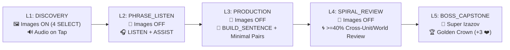

# 📖 CroLingo v2 Lesson Planning & Declarative Curriculum Authoring Playbook

> **Document Status:** 🏛️ **v2 CURRICULUM AUTHORING PLAYBOOK (DOC 4 — v2)**  
> **Supersedes (for Branch `v2`+):** [`docs/4. LESSON_PLANNING_GUIDE.md`](./4.%20LESSON_PLANNING_GUIDE.md) *(preserved for v1 historical reference)*  
> **Specification Contract:** [`docs/3. CURRICULUM_STANDARDS_V2.md`](./3.%20CURRICULUM_STANDARDS_V2.md)  
> **Rebuild & Cutover Docs:** [`docs/V2_REBUILD_LOG.md`](./V2_REBUILD_LOG.md) • [`docs/V2_CUTOVER_RUNBOOK.md`](./V2_CUTOVER_RUNBOOK.md)

---

## 1. Pedagogical Philosophy

CroLingo v2 is engineered for **diaspora children, heritage learners, and families (ages 5–14+)**:
- **Zero-Anxiety Discovery:** Lesson 1 (`DISCOVERY`) always pairs Croatian audio (`hr-HR-GabrijelaNeural`) with clear visual flashcards so kids attach sound to meaning before reading text alone.
- **Active Recall Over Passive Clicking:** Starting in World 2 (`LISTEN`) and World 4 (`BUILD_SENTENCE`), learners actively decode spoken Croatian and assemble real Croatian sentences from word-bank tiles.
- **Spaced Reinforcement Built In:** Lesson 4 (`SPIRAL_REVIEW`) pulls vocabulary and structures from prior units and worlds right before the forgetting curve dips, cementing retention ahead of the Lesson 5 **Super Izazov** capstone.

---

## 2. The v2 5-Lesson Unit Flow



---

## 3. Declarative Curriculum-as-Data Architecture

In v2, **curriculum lives in versioned YAML** under `curriculum/` instead of ad-hoc TypeScript seed scripts:

```text
curriculum/
├── grammar-ladder.yaml        # Official CEFR milestones per World (W1..W16+)
├── lexicon.yaml               # Canonical Croatian lexeme ledger (351+ stems)
└── worlds/
    ├── world-01-zagreb-central.yaml
    ├── ...
    └── world-12-velebit-paklenica-gacka.yaml
```

Every YAML file is validated by Zod (`lib/v2/curriculum-schema.ts`) and compiled deterministically into Lakebase Postgres (`db/schema.v2.ts`) via `npm run v2:compile`.

---

## 4. Step-by-Step Unit Authoring Workflow

1. **Check `curriculum/grammar-ladder.yaml`:** Confirm the World's CEFR band, target grammatical cases/tenses, and expected sentence length (`AvgW`).
2. **Author Lesson 1 (`DISCOVERY` — 4 `SELECT` Challenges, Images ON):**
   - Every challenge MUST be `type: SELECT` with 4 options, each carrying a valid `imageSrc` (`/slug.svg`) and `audioSrc` (`/audio/hr/<slug>.mp3`).
3. **Author Lesson 2 (`PHRASE_LISTEN` — 4 Challenges, Images OFF):**
   - Remove all `imageSrc` fields (`null`/omitted).
   - Include `LISTEN` challenges (`audioSrc` + 4 Croatian options, no English translation crutch) alongside `ASSIST` verb/phrase drills.
4. **Author Lesson 3 (`PRODUCTION` — 4 Challenges, Images OFF):**
   - Include `BUILD_SENTENCE` challenges (`targetSentence`, `wordBank` with 1–2 morphological distractor tiles, `audioSrc`) and minimal-pair `ASSIST` challenges (`W5+`).
5. **Author Lesson 4 (`SPIRAL_REVIEW` — 4 Challenges, Images OFF):**
   - Strictly NO images (`imageSrc` omitted).
   - Pull `>= 40%` of items from earlier units (`u - 2`, `u - 5`, `u - 10`) using `LISTEN`, `ASSIST`, and `BUILD_SENTENCE` (no single-word L1 flashcards in `W5+`).
6. **Author Lesson 5 (`BOSS_CAPSTONE` — 5–6 Challenges, Images OFF):**
   - Title includes `👑 Super Izazov: ...`.
   - Mixes the unit's vocabulary, grammar, and sentences; awards the Golden Crown and **`+3 ❤️`**.
7. **Synthesize Any New Croatian Audio:**
   - Generate missing `.mp3` clips with `hr-HR-GabrijelaNeural` into `public/audio/hr/`.
8. **Run Offline Quality Gates Before Compiling:**
   ```powershell
   npm run v2:validate
   npm run v2:pedagogy
   ```
9. **Compile to Isolated Staging (`v2-dev`):**
   ```powershell
   npm run v2:compile
   ```

---

## 5. Canonical v2 Unit YAML Template

```yaml
- order: 61
  title: "Unit 61"
  description: "Na tržnici u Splitu (At the Split Market)"
  lessons:
    - order: 1
      kind: DISCOVERY
      title: "Svježe voće (Fresh Fruit)"
      challenges:
        - order: 1
          type: SELECT
          prompt: 'Which one of these is "fig"?'
          grammarTags: ["nominative"]
          options:
            - text: "Smokva"
              correct: true
              imageSrc: "/smokva.svg"
              audioSrc: "/audio/hr/smokva.mp3"
            - text: "Jabuka"
              correct: false
              imageSrc: "/apple.svg"
              audioSrc: "/audio/hr/jabuka.mp3"
            - text: "Kruh"
              correct: false
              imageSrc: "/bread.svg"
              audioSrc: "/audio/hr/kruh.mp3"
            - text: "Sir"
              correct: false
              imageSrc: "/cheese.svg"
              audioSrc: "/audio/hr/sir.mp3"

    - order: 2
      kind: PHRASE_LISTEN
      title: "Poslušaj na tržnici (Listen at the Market)"
      challenges:
        - order: 1
          type: LISTEN
          prompt: "Listen and select the Croatian phrase"
          audioSrc: "/audio/hr/kupujemo_svjeze_smokve.mp3"
          grammarTags: ["accusative"]
          options:
            - text: "Kupujemo svježe smokve."
              correct: true
              audioSrc: "/audio/hr/kupujemo_svjeze_smokve.mp3"
            - text: "Kupili smo svježe smokve."
              correct: false
              audioSrc: "/audio/hr/kupili_smo_svjeze_smokve.mp3"
            - text: "Kupujemo svježi kruh."
              correct: false
              audioSrc: "/audio/hr/kupujemo_svjezi_kruh.mp3"
            - text: "Prodajemo svježe smokve."
              correct: false
              audioSrc: "/audio/hr/prodajemo_svjeze_smokve.mp3"

    - order: 3
      kind: PRODUCTION
      title: "Složi rečenicu (Build the Sentence)"
      challenges:
        - order: 1
          type: BUILD_SENTENCE
          prompt: 'Build in Croatian: "Tomorrow we will buy sweet figs at the market."'
          targetSentence: "Sutra ćemo kupiti slatke smokve na tržnici."
          audioSrc: "/audio/hr/sutra_cemo_kupiti_slatke_smokve_na_trznici.mp3"
          wordBank:
            - "Sutra"
            - "ćemo"
            - "kupiti"
            - "slatke"
            - "smokve"
            - "na"
            - "tržnici"
            - "smo"
            - "tržnicu"
          grammarTags: ["futur_1", "locative"]

    - order: 4
      kind: SPIRAL_REVIEW
      title: "Spiral Review"
      challenges: [] # 4 images-OFF items (>=40% from prior units/worlds)

    - order: 5
      kind: BOSS_CAPSTONE
      title: "👑 Super Izazov: Splitski pazar"
      challenges: [] # 5-6 cumulative images-OFF items (+3 hearts)
```

---

## 6. Pre-Compile Checklist

- [ ] Unit has **exactly 5 lessons** (`DISCOVERY`, `PHRASE_LISTEN`, `PRODUCTION`, `SPIRAL_REVIEW`, `BOSS_CAPSTONE`).
- [ ] Lesson 1 (`DISCOVERY`) has **100% `SELECT` challenges** with valid `.svg`/`.png` artwork on every option.
- [ ] Lessons 2–5 have **zero images** (`imageSrc` omitted / `null`).
- [ ] Lesson 4 (`SPIRAL_REVIEW`) pulls **`>= 40%` prior-unit/world items** (for `U2+`).
- [ ] Every multiple-choice challenge has **4 options** with uniform casing, identical ending punctuation, and valid `.mp3` audio on disk.
- [ ] `npm run v2:validate` exits `0` (`0` schema, rule, or asset errors).
- [ ] `npm run v2:pedagogy` exits `0` (`>= 4.3 / 5.0` alignment, `0` complexity dips).
