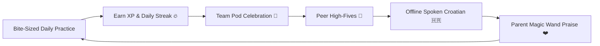

# ❤️ CroLingo Gamification, Retention & Engagement Engine

> **Document Status:** 🏛️ **GAMIFICATION & RETENTION SPECIFICATION (DOC 6)**  
> **Repository:** `AdminPhil/2lingo`  
> **Audience:** Product Designers, Educators, Game Designers, and Frontend Engineers  
> **Data Model & Schema:** For underlying database tables (`user_progress`, `pods`, `pod_members`, `pod_reactions`) and server actions, consult [`docs/2. ARCHITECTURE_AND_DATA.md`](./2.%20ARCHITECTURE_AND_DATA.md).

---

## 1. Pedagogical Gamification Philosophy

Children learn languages through **frequent, low-stakes practice** fueled by positive emotional reinforcement. CroLingo replaces the high-stress, punitive mechanics of traditional language apps with an encouraging, family-centered reward loop:

---

## 💔 2. Hearts & Precision Tracking

### The Problem
Children often "speed-guess" through multiple-choice questions by clicking options rapidly without reading or listening, knowing they can exploit free refills.

### The Mechanics
1. **The 5-Heart Energy Tank:**
   - Learners begin with a standard bank of **5 Hearts**.
   - Incorrect answers in standard lessons deduct 1 heart via `reduceHearts()`.
2. **Cumulative Precision Tracking (`hearts_used`):**
   - The system tracks lifetime hearts lost in `user_progress.hearts_used`.
   - Every mistake increments this metric, measuring precision over time.
3. **Leaderboard Display:**
   - Under each learner's name on the family leaderboard, precision is displayed transparently:
     `[XP] • 💔 [N] hearts used`
   - This celebrates thoughtful, deliberate reading rather than reckless speed-clicking.

---

## 🎯 3. "Practice to Earn a Heart" Engine

1. **Elimination of Free Refills:**
   - The unmetered "Free Refill" button has been eliminated.
   - Replaced with **"💪 Practice to Earn a Heart (+1 ❤️)"**.
2. **Review Quiz Sandbox:**
   - A dedicated **3-question quick quiz** dynamically samples challenges the child has already completed in previous units.
   - Answering all 3 review questions awards **+1 Heart** (up to the maximum of 5) and **+10 XP**.
   - During practice quizzes, mistakes do **not** cost hearts, providing a completely safe, low-anxiety revision environment.
3. **Voluntary Recharge (No Need to Fail First):**
   - Children can voluntarily top up their hearts anytime they are below 5 by tapping the Heart counter in the header bar (`UserProgress`).
   - Clicking opens the recharge modal: *"Need a Heart? ❤️ Complete 3 quick review questions to earn +1 Heart!"*
   - Eliminates the counter-intuitive behavior of having to intentionally fail a lesson just to trigger a refill.

---

## 👑 4. Super Izazov Milestone Heart Reward Engine (CR-029)

1. **Capstone Milestone Replenishment:**
   - Every unit concludes with **Lesson 4: Super Izazov (Boss Quest)**.
   - Successfully completing a Super Izazov automatically awards the learner **+1 Heart** (`Math.min(hearts + 1, 5)`).
2. **Mitigating Learner Fatigue:**
   - If a child struggled during the vocabulary fading or modular sentence phases (Lessons 2 & 3) and lost hearts, conquering the unit's final challenge restores a heart, empowering them to start the next unit with momentum.
3. **Finish Screen Feedback:**
   - The lesson finish screen features a special celebration banner:
     *"Svaka čast! 🌟 Osvojio si zlatnu krunu i zaradio novo srce! 🏆❤️"* along with an animated reward badge (*"❤️ Super Izazov Nagrada: +1 Novo Srce zarađeno!"*).
4. **Replay Mode Support:**
   - Replaying a previously completed Super Izazov from the learning map also rewards a heart upon completion, giving learners an adventurous alternative to the 3-question quick practice quiz.

---

## 🔥 5. Daily Streak Counter & Habit Flame Engine

1. **Daily Habit Loop:**
   - Vocabulary retention requires consistent daily contact. The streak counter tracks consecutive calendar days of practice.
   - Maintained via `streak` (integer) and `last_active_date` (`YYYY-MM-DD`) in `user_progress`.
2. **Consecutive Day Algorithm:**
   - **Same calendar day:** Practice maintains the streak and updates the timestamp without double-counting.
   - **Consecutive calendar day:** Practice increments the streak by **+1**.
   - **Missed 1+ days:** The streak resets gracefully to 1 day on the next practice session (unless protected by a parent grace day).
3. **Interactive UI (`UserProgress`):**
   - Clickable flame icon 🔥 with streak counter in the header bar (`[Flag] [🔥 Streak] [⚡ XP] [❤️ Hearts]`).
   - Clicking opens the **Daily Streak Celebration Modal** detailing current streak, encouraging daily vocabulary habits, and celebrating consistency.
4. **Leaderboard Metric:**
   - Displayed alongside accuracy under each learner:
     `🔥 [N] days • 💔 [N] hearts used`.

---

## 🌟 6. Collaborative Team Celebration Meter (CR-006)

1. **Knowledgehook Collective Model:**
   - Instead of a zero-sum, individualistic competition where younger siblings feel discouraged by older siblings' higher point totals, family pods share a **weekly collective XP target** (`target_xp`, default 1,000 XP).
   - Allows family members to pool their points toward a shared milestone.
2. **Multi-Pod XP Propagation:**
   - Every lesson completed, practice quiz finished, and praise points awarded simultaneously boosts the weekly celebration meter of every pod the child belongs to.
3. **Interactive Celebration Thermometer (`<PodCelebrationMeter />`):**
   - Renders at the top of the Leaderboard with real-time percentage fill, remaining XP countdown, and celebration status.
   - Reaching 1,000 XP unlocks full-screen celebratory confetti (`react-confetti`) and triggers the celebration dialog with dancing Paško.

---

## 👋 7. Peer High-Fives & Social Cheer Engine (CR-007)

1. **Low-Stress Social Loop:**
   - Learners can celebrate each other's progress and streaks by tapping the **"High-Five 👋"** button next to any family member on the Leaderboard.
2. **Anti-Spam & COPPA Design:**
   - Pre-set positive canned reactions only (`high_five`, `star`, `flame`). No open chat or free text input.
   - Built-in rate limiting: maximum 1 cheer per recipient per calendar day.
3. **Notification & Micro-Bonus:**
   - Unread cheers trigger the animated `<CheerBanner />` on `/learn` and `/leaderboard`:
     *"🎉 [Sender] sent you a High-Five! Tap to claim +5 XP! 👋"*
   - Claiming awards **+5 XP** to the recipient and contributes +5 XP to all active family pods.

---

## 🪄 8. Parent Magic Wand Overrides (CR-011)

CroLingo equips parents with discretionary tools in the Parent Center (`/admin`) to support younger children through difficult moments:

1. **Frustration Dissolution (Instant Refill):**
   - Parents can replenish a child's hearts from 0 or 1 back to 5/5 with one tap via `adminRefillHearts()`.
   - Protects younger children from frustration or lesson abandonment after challenging concepts.
2. **Streak Grace Protection:**
   - Parents can grant an emergency streak protection grace day via `adminProtectStreak()`.
   - Protects multi-day flames during busy travel days, sickness, or school events.
3. **Real-Life Croatian Praise Engine:**
   - Parents can reward offline spoken Croatian practice (e.g., ordering at a bakery, speaking with *Baka & Dida* in Croatia, or saying polite words at dinner) with **+25 or +50 XP** via `adminAwardPraiseXp()`.
   - Praise points propagate to both individual learner profiles and active family pods.
