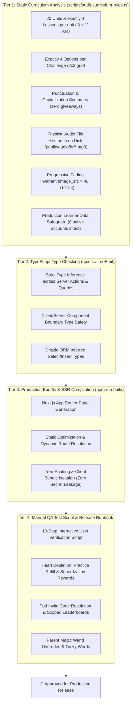

# 🧪 CroLingo Quality Assurance, Testing Strategy & Release Verification

> **Document Status:** 🏛️ **TESTING STRATEGY & QA RUNBOOK (DOC 8)**  
> **Repository:** `AdminPhil/2lingo`  
> **Audience:** Developers, Contributors, Pairing Agents, and QA Testers  
> **Pre-Merge Policy:** See [`docs/GOVERNANCE.md`](./GOVERNANCE.md).  
> **Research Spike Plan:** See [`research_spike_test_suite_plan_and_qa_strategy.md`](file:///C:/Users/phili/.gemini/antigravity/brain/55f357f0-ec5b-4e75-a1a5-c126f66f54df/research_spike_test_suite_plan_and_qa_strategy.md).

---

## 1. Quality Assurance Philosophy: Multi-Tier Protection

CroLingo enforces a **4-tier quality assurance pipeline** to ensure every release is pedagogically sound, visually harmonious, and functionally bulletproof across all viewports (desktop, tablet, iPad, and mobile 320px–390px):



---

## 2. The 4-Tier Verification Pipeline

### Tier 1: Static Curriculum & Data Audit
- **Command:** `npx tsx --env-file=.env.local scripts/audit-curriculum-rules.ts`
- **Execution Speed:** ~2 seconds.
- **Fail Criteria:** 
  - Any challenge with fewer or more than 4 options.
  - Trailing punctuation giveaways or mismatched casing.
  - Any option pointing to a missing `.mp3` file on disk under `public/audio/hr/`.
  - Any illegal image on Lessons 2, 3, or 4.
  - Any drop in the 8 active production learner accounts (`Adriana`, `Silvia`, `Vanessa`, `Zvon`).
- **Gate:** Hard blocker (0 violations permitted).

### Tier 2: Strict TypeScript Type Check
- **Command:** `npx tsc --noEmit`
- **Execution Speed:** ~7 seconds.
- **Fail Criteria:** Any type mismatch, unhandled null/undefined property access, broken Server Action signature, or improper Radix UI prop passing.
- **Gate:** Hard blocker (0 errors permitted).

### Tier 3: Production Bundle & SSR Compilation
- **Command:** `npm run build`
- **Execution Speed:** ~35–50 seconds.
- **Fail Criteria:** Unresolved module imports, illegal `"use client"` vs `"use server"` imports, server secrets bundled in client components, or broken static metadata generation.
- **Gate:** Hard blocker (Must compile cleanly).

### Tier 4: Manual QA Test Script & Release Verification
- **Runbook:** Step-by-step interactive verification before promoting code from Staging to Production.

---

## 3. Tier 4: The 10-Point Manual QA Test Script & Release Runbook

Execute this 10-point checklist before every production deployment:

| Step # | Flow / Feature Area | Test Action | Expected Result | Pass/Fail Criteria |
| :---: | :--- | :--- | :--- | :--- |
| **1** | **Landing Page & Branding** | Visit `/` on Desktop & Mobile (390px). | • Header shows Paško logo and "CroLingo" typography in National Heritage Navy.<br/>• Dual 56px action buttons have tactile 3D depth.<br/>• Cultural pill badge reads "100% Focused on Croatian". | No horizontal overflow; buttons trigger Clerk modal. |
| **2** | **Learner Auth & Navigation** | Sign in as a Young Learner. | • Lands on `/learn` with zero blocking administrative popups.<br/>• Smooth scroll positions viewport at `#current-lesson`.<br/>• Top bar displays [Flag] [🔥 Streak] [⚡ XP] [❤️ Hearts]. | Immediate access to Unit 1 without friction. |
| **3** | **World Theming & Banners** | Scroll down `/learn` through all 4 Worlds. | • World 1: Red buttons & Castles banner.<br/>• World 2: Azure buttons & Adriatic Sea banner.<br/>• World 3: Emerald buttons & Plitvice Lakes banner.<br/>• World 4: Royal Navy buttons & King's Landing banner.<br/>• Top badge spans full width; `Nastavi` is aligned lower. | Banners do not wrap awkwardly; buttons match World theme colors. |
| **4** | **In-Lesson Quiz Loop** | Start a lesson in Unit 1. | • Questions load with Croatian prompt and Paško question bubble.<br/>• Tapping speaker button plays audio (`GabrijelaNeural`).<br/>• Keyboard shortcuts `1`, `2`, `3`, `4` select cards cleanly.<br/>• Number badges do not collide with speaker icons on compact tiles. | Audio plays clearly; options submit smoothly. |
| **5** | **Heart Depletion & Precision** | Intentionally select an incorrect option. | • Heart count decrements by 1 (e.g. 5 $\rightarrow$ 4).<br/>• Red error banner appears at bottom.<br/>• In database, `user_progress.hearts_used` increments by +1.<br/>• Mistake is logged to `challenge_mistakes`. | Heart deducts accurately; mistake logged. |
| **6** | **Practice-to-Earn Refill** | When hearts < 5, tap Heart icon and select "Practice to Earn a Heart". | • Opens 3-question review quiz sandbox.<br/>• Errors in practice quiz do NOT cost hearts.<br/>• Completing the 3 questions awards **+1 Heart** and **+10 XP**.<br/>• Success toast confirms recharge. | Heart count increases by 1 without penalty. |
| **7** | **Super Izazov Milestone Bonus** | Complete Lesson 4 (Boss Quest) of any unit. | • Finish screen features Golden Trophy Crown animation.<br/>• Celebratory banner reads: *"Svaka čast! Osvojio si zlatnu krunu i zaradio novo srce!"*<br/>• Learner is awarded **+1 Heart** (`Math.min(hearts+1, 5)`). | +1 Heart granted; crown unlocked on path. |
| **8** | **Daily Streak Engine** | Complete a practice lesson. | • Tapping flame icon 🔥 opens Daily Streak modal.<br/>• Streak increments if first practice of a new calendar day.<br/>• Leaderboard updates precision and streak metrics: `🔥 [N] days • 💔 [N] hearts used`. | Streak updates; modal displays current flame count. |
| **9** | **Family Pods & Social Cheers** | Visit `/leaderboard`. | • Pod celebration thermometer renders at top with weekly progress towards 1,000 XP.<br/>• Tapping "High-Five 👋" sends cheer to family member.<br/>• Recipient sees animated `<CheerBanner />` on `/learn` and claims +5 XP. | Rate limited to 1/day; points pool to pod. |
| **10** | **Parent Center & Magic Wands** | Sign in as Parent and visit `/admin`. | • Tricky Words card lists recent mistakes with pedagogical tips.<br/>• Tapping Magic Wand "Refill Hearts" restores child to 5/5.<br/>• Tapping "Award Praise" awards +25 XP for offline Croatian conversation. | Overrides execute instantly; child updates in real-time. |

---

## 4. Automated Testing Evolution Roadmap

To complement the manual QA script, here is the technical architecture for phased automated test expansion:

### Phase 1: Unit & Algorithm Testing (Vitest)
- **Target Utilities:**
  - `lib/theme-registry.ts` (World color mappings and boundaries)
  - `lib/tts.ts` (Speech synthesis fallbacks)
  - `actions/pod.ts` (`generateRandomPodCode` character set and collision checks)
  - Consecutive calendar day streak calculation algorithms
- **Setup Command:**
  ```bash
  npm install -D vitest @vitejs/plugin-react
  ```

### Phase 2: Component & Visual Snapshot Testing (Playwright Component Testing)
- **Target Components:**
  - `UnitBanner` (asserts full-width title clearance without awkward badge wrapping)
  - `Card` (`SELECT` image mode vs compact text-only mode to prevent icon collisions)
  - `UserProgress` (header bar responsiveness across 320px–1200px)
  - `HeartsModal` (practice quiz recharge dialog)

### Phase 3: Headless End-to-End Testing (Playwright E2E)
- **Target User Journeys:**
  1. Complete full lesson quiz with 100% correct answers.
  2. Voluntary practice quiz heart recharge when depleted.
  3. Parent Center child account creation via Clerk Backend API.
- **Cross-Browser Verification:** Real Chromium, WebKit (Safari/iPad simulation), and Mobile Viewports (390px iPhone).
