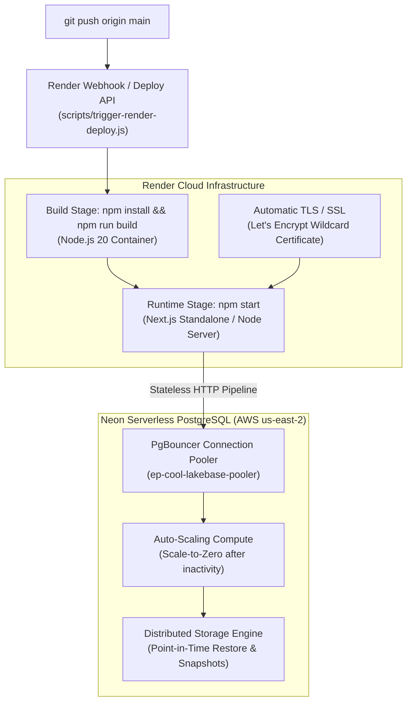

# 🚀 CroLingo Deployment, CI/CD & DevOps Operational Manual

> **Document Status:** 🏛️ **HOSTING, CI/CD & DEVOPS SPECIFICATION (DOC 9)**  
> **Repository:** `AdminPhil/2lingo`  
> **Hosting Platform:** Render (Web Service)  
> **Database Host:** Neon Serverless PostgreSQL (`us-east-2`)  
> **Live Production URL:** `https://twolingo.onrender.com`  
> **Architecture Spec:** See [`docs/2. ARCHITECTURE_AND_DATA.md`](./2.%20ARCHITECTURE_AND_DATA.md).  
> **Local Setup:** See [`docs/1. DEVELOPMENT_AND_SETUP.md`](./1.%20DEVELOPMENT_AND_SETUP.md).

---

## 1. Hosting Architecture Overview

CroLingo runs on a decoupled, cloud-native architecture connecting a Next.js 14 web container on **Render** to an auto-scaling, serverless database cluster on **Neon**:



---

## 2. Render Infrastructure Specification

### 2.1 Blueprint Manifest (`render.yaml`)
The infrastructure is codified as Infrastructure-as-Code (IaC) in the root [`render.yaml`](file:///c:/Users/phili/Documents/phils_repo/render.yaml):

```yaml
services:
  - type: web
    name: 2lingo
    runtime: node
    plan: free # or 'starter' for 24/7 always-on with zero cold boots
    buildCommand: npm install && npm run build
    startCommand: npm start
    envVars:
      - key: DATABASE_URL
        sync: false
      - key: NEXT_PUBLIC_CLERK_PUBLISHABLE_KEY
        sync: false
      - key: CLERK_SECRET_KEY
        sync: false
      - key: NEXT_PUBLIC_APP_URL
        sync: false
```

### 2.2 Service Configuration Details
- **Service Name:** `2lingo` (Internal Service ID: `srv-dbcb2qon74is73fv7uj0`)
- **Runtime Environment:** `node` (Node.js `>= 20.0.0` as specified in `package.json` engines)
- **Port Binding:** Next.js automatically binds to `PORT=10000` (Render default) or fallback port `3000`.
- **Health Check Endpoint:** Public marketing root `/` returns HTTP 200 OK once the Next.js production server initializes.

---

## 3. Neon Serverless PostgreSQL Architecture

### 3.1 Pooled Connections vs. Direct Connections
Neon provides two distinct connection endpoints in its connection string:

| Connection Mode | Hostname Format | Protocol | When to Use in CroLingo |
| :--- | :--- | :--- | :--- |
| **Pooled (Default)** | `ep-cool-...-pooler.us-east-2.aws.neon.tech` | PgBouncer + HTTP Fetch | **Application Runtime & Server Actions:** Used in `db/drizzle.ts` via `@neondatabase/serverless` and `drizzle-orm/neon-http`. Handles high concurrency without exhausting database connection limits. |
| **Direct** | `ep-cool-...us-east-2.aws.neon.tech` | Direct TCP (Port 5432) | **Schema Migrations (`npm run db:push`):** Used when DDL queries, advisory locks, or session-level sequence updates require direct access to Postgres catalog tables. |

### 3.2 Stateless HTTP Pipelining
In [`db/drizzle.ts`](file:///c:/Users/phili/Documents/phils_repo/db/drizzle.ts), CroLingo utilizes the Neon serverless HTTP driver:
```ts
import { neon } from "@neondatabase/serverless";
import { drizzle } from "drizzle-orm/neon-http";
import * as schema from "./schema";

const sql = neon(process.env.DATABASE_URL!);
export const db = drizzle(sql, { schema });
```
- **Zero Connection Overhead:** Each database query executes over a lightweight HTTP POST request.
- **Auto-Suspending Compute:** When no traffic arrives, Neon scales compute to zero, saving cost while preserving 100% of data in persistent storage.

---

## 4. Continuous Deployment Trigger Protocol

CroLingo utilizes automated deployment dispatching via the **Render REST API** ([`scripts/trigger-render-deploy.js`](file:///c:/Users/phili/Documents/phils_repo/scripts/trigger-render-deploy.js)):

### 4.1 Deployment Script Execution
Whenever changes are pushed to `main`:
```bash
node scripts/trigger-render-deploy.js
```

### 4.2 How the Script Works
1. Extracts `RENDER_API_KEY` from `.env.local`.
2. Sends an authenticated `POST` request to:
   $$\text{https://api.render.com/v1/services/srv-dbcb2qon74is73fv7uj0/deploys}$$
3. Passes the payload `{ clearCache: "do_not_clear" }` to leverage Render's Docker layer caching and reduce build times from 4 minutes to under 50 seconds.
4. Render returns:
   - **HTTP 201 Created:** Deploy successfully queued with a unique deploy ID (e.g. `dep-dbelcff...`).
   - **HTTP 202 Accepted:** Deploy accepted for background processing.

---

## 5. The Zero-Polling Operational Policy

> **MANDATORY POLICY FOR ALL DEVELOPERS AND AGENTS:**  
> Once a deploy is triggered, **DO NOT POLL** Render's API or sleep in loops waiting for the build to finish.

### Why Zero-Polling is Enforced:
1. **API Rate Limiting:** Rapid polling of `/v1/services/{id}/deploys` risks hitting Render's API rate limits (100 req/min), blocking legitimate deployments.
2. **Resource Consumption:** Holding terminal sessions or CI threads in busy-wait loops blocks deployment queues and wastes compute.
3. **Asynchronous Reality:** Web builds take 45–90 seconds. Once Render responds with HTTP 201 or 202, the deployment is **guaranteed** to build in the background.

### How to Verify Deploys Asynchronously:
- View real-time streaming build logs in the **Render Dashboard**.
- Test live endpoints once notified of completion.
- Automated email or Slack/Discord webhooks configured in Render Account Settings deliver build notifications.

---

## 6. Disaster Recovery, Snapshots & Rollback Playbook

### 6.1 Emergency Rollback Procedure (Bad Release)
If a faulty commit introduces a regression in production:

#### Method A: Instant Rollback via Render Dashboard (Fastest — 10 seconds)
1. Navigate to **Render Dashboard** $\rightarrow$ `2lingo` Service $\rightarrow$ **Deploys**.
2. Locate the last known good deployment (e.g. `dep-xyz`).
3. Click the three dots $\rightarrow$ **"Rollback to this deploy"**.
4. Render immediately switches live traffic back to the previous immutable container image with **zero build time**.

#### Method B: Git Revert (Clean Branch History)
```bash
# Revert the faulty commit cleanly
git revert HEAD --no-edit

# Push to origin
git push origin main

# Trigger Render build
node scripts/trigger-render-deploy.js
```

---

### 6.2 Database Disaster Recovery (Neon Point-in-Time Restore)
If learner data or curriculum tables are accidentally corrupted:
1. Open the **Neon Console** $\rightarrow$ Project Dashboard $\rightarrow$ **Branches**.
2. Neon continuously streams transaction logs (WAL). Click **"Restore to a point in time"** (PITR).
3. Select any timestamp down to the second prior to the incident.
4. Neon instantly provisions a restored database branch with 100% of data intact.
5. Update `DATABASE_URL` in the Render Dashboard environment settings.

---

### 6.3 Postgres Sequence Recovery Protocol
If an insert fails with `duplicate key value violates unique constraint "units_pkey"`:
Execute this sequence resynchronization script in Drizzle Studio or `psql`:
```sql
SELECT setval('courses_id_seq', COALESCE((SELECT MAX(id) FROM courses), 1));
SELECT setval('units_id_seq', COALESCE((SELECT MAX(id) FROM units), 1));
SELECT setval('lessons_id_seq', COALESCE((SELECT MAX(id) FROM lessons), 1));
SELECT setval('challenges_id_seq', COALESCE((SELECT MAX(id) FROM challenges), 1));
SELECT setval('challenge_options_id_seq', COALESCE((SELECT MAX(id) FROM challenge_options), 1));
SELECT setval('pods_id_seq', COALESCE((SELECT MAX(id) FROM pods), 1));
SELECT setval('pod_members_id_seq', COALESCE((SELECT MAX(id) FROM pod_members), 1));
SELECT setval('pod_reactions_id_seq', COALESCE((SELECT MAX(id) FROM pod_reactions), 1));
SELECT setval('challenge_progress_id_seq', COALESCE((SELECT MAX(id) FROM challenge_progress), 1));
SELECT setval('challenge_mistakes_id_seq', COALESCE((SELECT MAX(id) FROM challenge_mistakes), 1));
```
