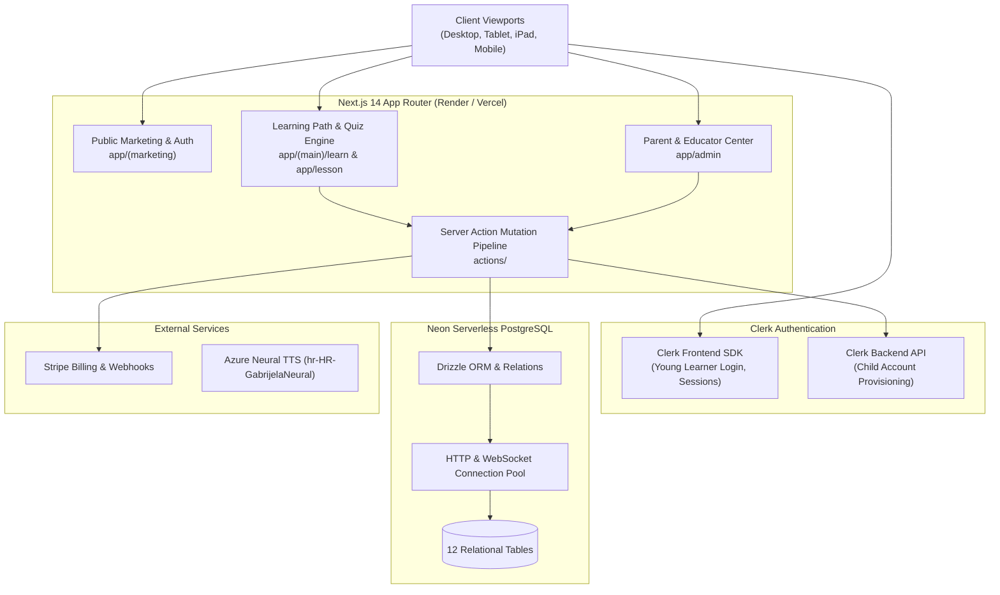
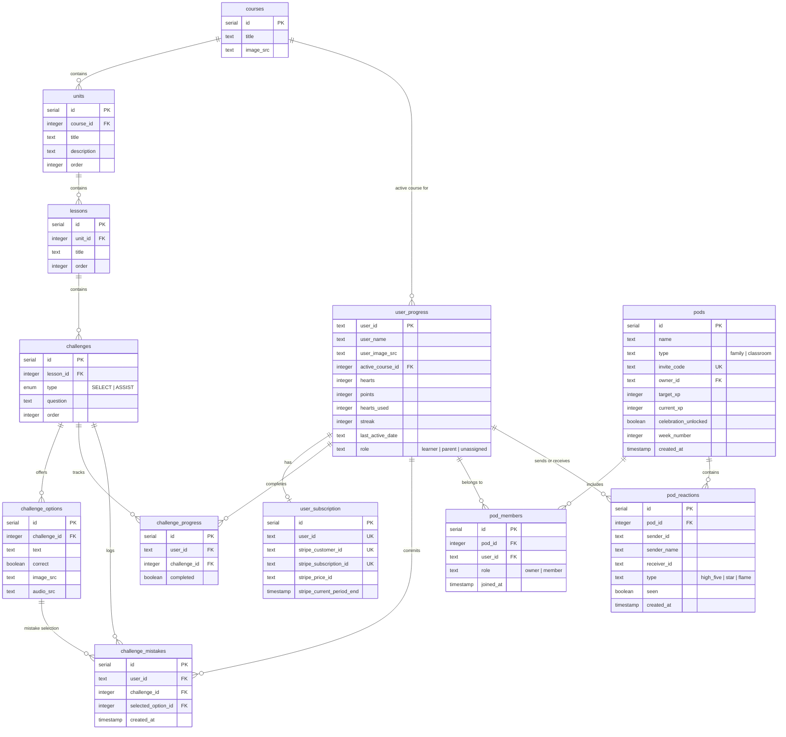
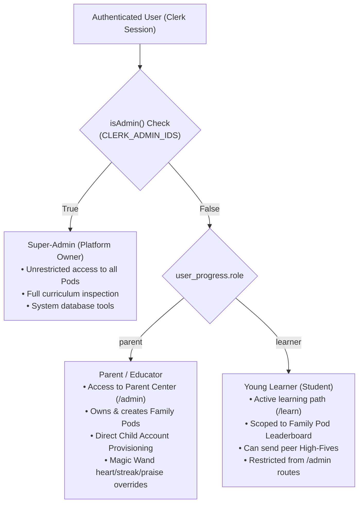

# ⚙️ CroLingo System Architecture & Engineering Specification

> **Document Status:** 🏛️ **CORE ENGINEERING SPECIFICATION**  
> **Repository:** `AdminPhil/2lingo`  
> **Source of Truth:** Data modeling, database relationships, user hierarchies, and server action contracts.  
> **Pedagogical Spec:** See [`docs/CURRICULUM_STANDARDS.md`](file:///c:/Users/phili/Documents/phils_repo/docs/CURRICULUM_STANDARDS.md) for curriculum rules.  
> **Developer Setup:** See [`README.md`](file:///c:/Users/phili/Documents/phils_repo/README.md) for local environment configuration.

---

## 1. System Overview

CroLingo is a full-stack, cloud-native web application built on **Next.js 14**, **Neon Serverless PostgreSQL**, and **Clerk Authentication**:



---

## 2. Entity Relationship Diagram (ERD)

The complete data model spans 12 relational tables managed via Drizzle ORM:



---

## 3. Database Schema Dictionary

### 3.1 Curriculum Hierarchy
- **`courses`:** Top-level language track (`id: 1` = Croatian).
- **`units`:** Ordered curriculum units (20 units across 4 regional Worlds). Cascades delete to lessons.
- **`lessons`:** Exactly 4 lessons per unit ("3 + 1" Unit Arc). Cascades delete to challenges.
- **`challenges`:** Individual questions. Enumerated type: `SELECT` (image cards or compact choice tiles) or `ASSIST` (text list cards).
- **`challenge_options`:** Exactly 4 options per challenge. Stores `text`, `correct` flag, `image_src` (null for Lessons 2–4), and `audio_src`.

### 3.2 Learner State & Analytics
- **`user_progress`:** Primary learner record keyed on Clerk `user_id`. Tracks current `hearts` (0–5), `points` (XP), cumulative precision penalty `hearts_used`, consecutive habit `streak`, `last_active_date` (`YYYY-MM-DD`), and system `role`.
- **`challenge_progress`:** Tracks completed challenge prompts per learner.
- **`challenge_mistakes`:** Audit log of incorrect submissions. Used by the Parent Center Tricky Words report to highlight vocabulary requiring review.
- **`user_subscription`:** Stripe subscription status for Pro memberships.

### 3.3 Collaborative Pods & Social Engine
- **`pods`:** Family circles and learning groups. Tracks shared weekly collective goal (`target_xp`, default 1,000 XP), current pooled progress (`current_xp`), and whether the celebratory confetti threshold is unlocked (`celebration_unlocked`).
- **`pod_members`:** Join table linking learners and parents to pods with roles (`owner` vs `member`).
- **`pod_reactions`:** High-fives and cheer notifications exchanged between family members. Includes `seen` flag to drive the animated `<CheerBanner />`.

---

## 4. User Identity & Role Hierarchy

CroLingo enforces a three-tier user hierarchy built on Clerk authentication:



### 4.1 Child Account Provisioning Architecture
Young children often lack email addresses or phone numbers. CroLingo solves this via the **Direct Child Account Provisioning Engine** ([`actions/child-account.ts`](file:///c:/Users/phili/Documents/phils_repo/actions/child-account.ts)):
1. The parent enters a simple username (e.g., `luka_dalmacija`) and password in the Parent Center.
2. The server action calls the **Clerk Backend REST API** using `CLERK_SECRET_KEY` to create a managed user account with zero email verification requirement.
3. The server action initializes `user_progress` with `role: "learner"` and automatically inserts a `pod_members` record binding the child to the parent's active pod.
4. The child can immediately log in on an iPad or tablet using the username and password.

---

## 5. Learning Pods Authorization & Scoping Mechanics

### 5.1 Relational Privacy Scoping
CroLingo enforces child privacy by scoping leaderboards to **authorized pod members only** ([`db/queries.ts`](file:///c:/Users/phili/Documents/phils_repo/db/queries.ts) → `getTopTenUsers`):
```sql
SELECT up.* FROM user_progress up
JOIN pod_members pm ON up.user_id = pm.user_id
WHERE pm.pod_id = :activePodId AND up.role = 'learner'
ORDER BY up.points DESC LIMIT 10;
```
- Children never see strangers, public accounts, or global internet users.
- Super-admin and developer test accounts are filtered out of student leaderboards by default.

### 5.2 Multi-Pod XP Propagation
When a child completes a challenge (`upsertChallengeProgress`), practices to earn a heart (`practiceToEarnHeart`), or receives parental praise (`adminAwardPraiseXp`):
1. Their individual `user_progress.points` increments.
2. The action triggers `awardPodXp(userId, xp)`.
3. The database updates `pods.current_xp = current_xp + xp` across **every pod the learner belongs to**.
4. If `current_xp >= target_xp`, `celebration_unlocked` is set to `true`, triggering celebratory confetti and team reward modals.

---

## 6. Server Action Mutation Pipelines

All data mutations in CroLingo execute through strictly typed Next.js Server Actions:

| Server Action File | Primary Actions | State & Side-Effects |
| :--- | :--- | :--- |
| **`actions/challenge-progress.ts`** | `upsertChallengeProgress()` | Records challenge completion, awards +10 XP, restores **+1 Heart on Super Izazov**, propagates XP to active pods, logs mistakes on failure. |
| **`actions/user-progress.ts`** | `reduceHearts()`<br/>`refillHearts()`<br/>`practiceToEarnHeart()` | Increments `hearts_used`, deducts heart on quiz error, resets hearts to 5, awards +1 Heart and +10 XP upon completing 3-question review quiz. |
| **`actions/pod.ts`** | `joinPodByCode()`<br/>`createPod()`<br/>`awardPodXp()` | Validates 6-character invite code, enrolls learner, recalculates weekly celebration meter. |
| **`actions/admin-overrides.ts`** | `adminRefillHearts()`<br/>`adminProtectStreak()`<br/>`adminAwardPraiseXp()` | Parent Magic Wand overrides: restores child hearts to 5, grants streak grace day, rewards offline Croatian conversation with +25/+50 XP. |
| **`actions/child-account.ts`** | `createChildAccount()` | Calls Clerk Backend API to provision email-less child logins and enrolls them in parent's pod. |
| **`actions/cheer.ts`** | `sendCheer()`<br/>`markCheerAsSeen()` | Delivers peer high-fives with daily rate limits; claiming awards +5 XP to recipient and active pods. |

---

## 7. Database Invariants & Sequence Synchronization

To maintain database integrity across migrations, seed scripts, and production operations:

### 7.1 User Progress Preservation Invariant
> **CRITICAL RULE:** Curriculum seeding scripts (`scripts/seed.ts`, `scripts/prod.ts`) must **NEVER** drop or truncate `user_progress`, `challenge_progress`, `pods`, or `pod_members`. Active learner XP (e.g. Adriana: 2,230 XP, Silvia: 1,325 XP) must remain strictly intact across all deploys.

### 7.2 Dynamic Coordinate Lookup
Neon Postgres auto-increment IDs shift across re-seeds. Refinement scripts must never hardcode database IDs. Always lookup challenges via hierarchical coordinates:
$$\text{Coordinate} = (\text{unit\_order}, \text{lesson\_order}, \text{challenge\_order})$$

### 7.3 Postgres Sequence Synchronization
After any bulk insert into tables with `serial` primary keys, Postgres sequences must be synchronized to prevent `duplicate key value violates unique constraint` errors:
```sql
SELECT setval('units_id_seq', (SELECT MAX(id) FROM units));
SELECT setval('lessons_id_seq', (SELECT MAX(id) FROM lessons));
SELECT setval('challenges_id_seq', (SELECT MAX(id) FROM challenges));
SELECT setval('challenge_options_id_seq', (SELECT MAX(id) FROM challenge_options));
SELECT setval('pods_id_seq', (SELECT MAX(id) FROM pods));
```

---

## 8. Asset Architecture & Deployment Pipeline

- **Audio Assets (`public/audio/hr/*.mp3`):** Synthesized using Azure Cognitive Services Neural Croatian TTS (`hr-HR-GabrijelaNeural` at `-5%` rate). Automated via `scripts/generate_croatian_audio.py`.
- **Mascot Artwork (`public/mascot.png`, `public/pasko-hero.jpg`):** High-resolution digital illustrations featuring Paško the Dalmatian pup, Croatian folk gingerbread hearts (*licitarsko srce*), coastal ferries (*trajekt*), and checkerboard (*šahovnica*) tokens.
- **Render Deployment Pipeline:**
  - Tracked on Render Web Service via `render.yaml`.
  - Deploys automatically triggered via `scripts/trigger-render-deploy.js` executing asynchronously with zero polling.
