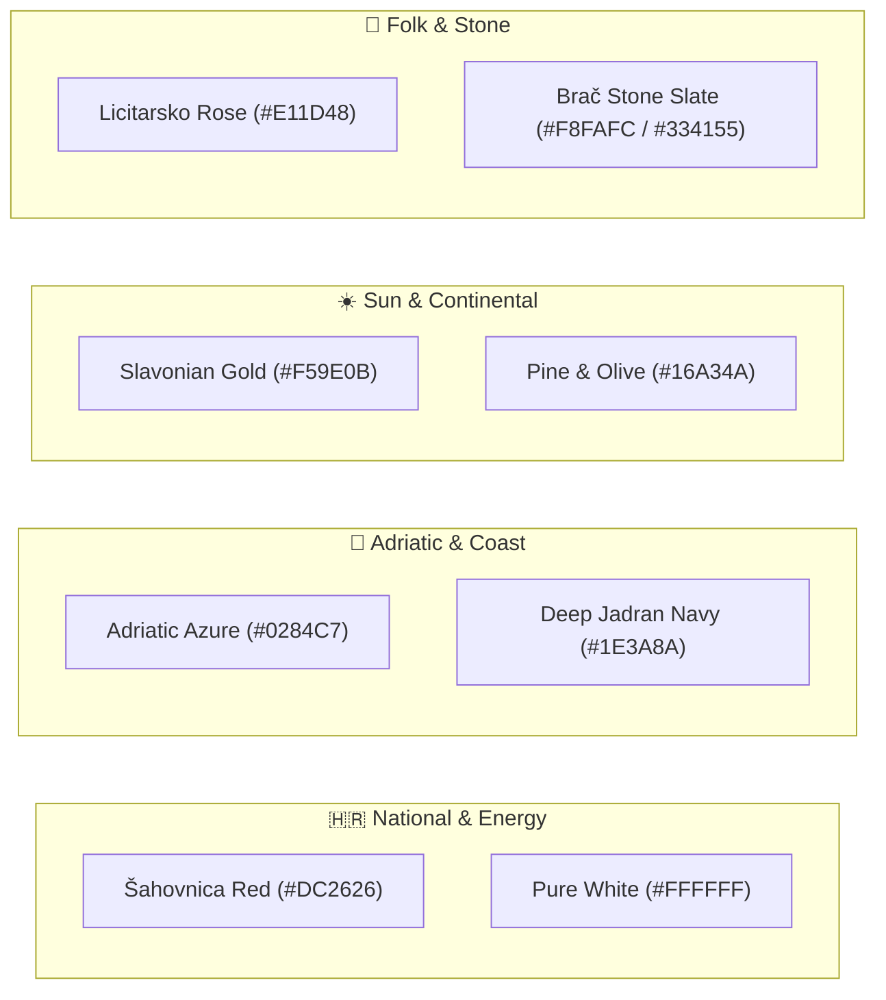
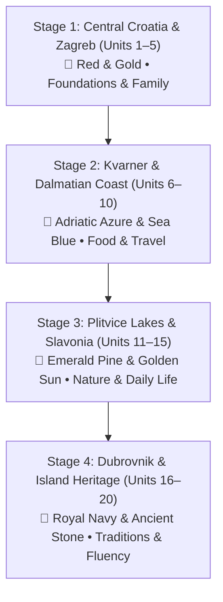
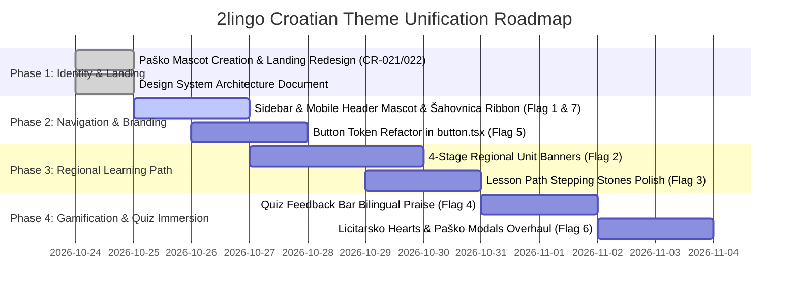

# 🎨 2lingo Living Design System & Croatian Theme Guide

> **Document Status:** 🏛️ **ACTIVE LIVING DESIGN SYSTEM**  
> **Repository:** `AdminPhil/2lingo`  
> **Standard:** Professional UX/UI Design Standard for Ed-Tech & Cultural Heritage  
> **Audience:** Product Owners, UX/UI Designers, and Full-Stack Engineers  
> **Primary Goal:** Unify the visual brand, pedagogical tone, and design language across all touchpoints (marketing landing, learning path, quiz challenges, gamification, and parent center) under an authentic Croatian cultural identity.

---

## 1. Executive Summary & Design Vision

### 1.1 The Core Problem
2lingo originally inherited the design language of a generic Duolingo clone: Duolingo-specific lime green (`#58cc02`), flat repetitive unit cards, a generic green cube mascot, and generic blue/sky button classes. While functional, it lacked any genuine sense of place, heritage, or cultural emotional connection.

With the delivery of **Paško the Dalmatian**, the redesigned landing page, and authentic Croatian assets (trajekt, licitarsko srce, Mediterranean characters), the public entry point now feels vibrant, proud, and authentically Croatian. **However, stepping past the landing page into `/learn`, `/lesson`, `/leaderboard`, and `/admin` still presents the old generic green aesthetic.** This creates an inconsistent, disjointed user experience.

### 1.2 The Design Vision
2lingo should feel like **a joyful cultural journey across Croatia**. Every visual touchpoint—from the mascot to the unit map, button depth, praise animations, and parent reports—should reflect the warm, sunlit colors of the Adriatic, the historic stone of coastal towns, the iconic red-and-white *šahovnica*, and the golden fields of the continental regions.

---

## 2. Current State Audit & Inconsistency Flags

| Screen / Area | Current Visual State | Identified Inconsistency / Issue | Target Vision (Action Item) | Priority |
| :--- | :--- | :--- | :--- | :--- |
| **Landing Page** (`/(marketing)`) | Redesigned with Paško hero art, 3D title-case dual gates, and *šahovnica* conic ribbon. | High fidelity, but standalone; disconnected from inner app styling. | Establish as the benchmark standard for typography, depth, and motifs. | ✅ Solved (CR-021/022) |
| **Top Navigation & Sidebar** (`components/sidebar.tsx`, `components/mobile-header.tsx`) | Still uses legacy green mascot SVG in some places; generic sky-blue active sidebar pill (`bg-sky-500/15`). | Mascot inconsistency; sidebar active color does not align with the Croatian palette. | Update mascot logo to Paško (`/mascot.png`); switch active pill to Adriatic Azure / Pine. | 🔴 High (Flag 1) |
| **Learning Path Unit Banners** (`app/(main)/learn/unit-banner.tsx`) | Monolithic flat lime green (`bg-green-500`) across all 20 units without variation. | Visually monotonous; misses huge pedagogical opportunity to represent Croatia's 4 distinct geographic regions. | Introduce 4 regional color themes (Zagreb/Continental, Dalmatia/Islands, Slavonia/Plitvice, Dubrovnik/Heritage). | 🔴 High (Flag 2) |
| **Lesson Path Nodes** (`app/(main)/learn/lesson-button.tsx`) | Generic Duolingo green buttons, yellow crown final boss, locked gray. | Serviceable, but lacks Croatian map flavor (e.g. stepping stones between Adriatic islands). | Add subtle wave textures or stone path styling; preserve high-contrast accessibility. | 🟡 Medium (Flag 3) |
| **Lesson Quiz Feedback Bar** (`app/lesson/footer.tsx`) | English-only text: `"Nicely done!"` on flat green / `"Try again."` on flat rose. | Misses conversational Croatian immersion at the moment of highest learner dopamine. | Introduce warm Croatian praise: `"Bravo!"` / `"Izvrsno! 🇭🇷"` with bilingual subtitles. | 🔴 High (Flag 4) |
| **Button Variant System** (`components/ui/button.tsx`) | Legacy Duolingo variants: `primary` (sky blue), `secondary` (green), `super` (indigo), `golden` (amber). | Confusing naming (`primary` vs `secondary`); colors are not mapped to brand semantic tokens. | Map variants to semantic Croatian design tokens (Adriatic, Emerald, Zlato, Rubin, Stone). | 🟡 Medium (Flag 5) |
| **Gamification Icons** (Streaks, Hearts, Points) | SVG assets exist, but generic heart and streak styling. | Hearts could celebrate traditional red *Licitarsko Srce*; Streaks could celebrate the Adriatic sun / Olympic flame. | Subtle iconography polish harmonizing with the new Paško theme. | 🟢 Low (Flag 6) |
| **Parent Center** (`/admin`) | Rich cards, but header styling doesn't feature the *šahovnica* accent ribbon seen on the landing page. | Header branding differs between public marketing and private parent portal. | Add matching Croatian ribbon and Paško brand elements to `/admin`. | 🟡 Medium (Flag 7) |

---

## 3. The Croatian Cultural Color Palette

Our palette is directly inspired by Croatia's natural landscapes, architecture, and cultural traditions:



### 3.1 Primary Brand Tokens

| Token Name | Hex Code | Tailwind Equivalent | Cultural Reference | Usage in App |
| :--- | :--- | :--- | :--- | :--- |
| **`cro-red-primary`** | `#DC2626` | `red-600` | Croatian Coat of Arms (*Grb / Šahovnica*) | Header accent ribbon, key badges, high-impact alerts |
| **`cro-red-licitar`** | `#E11D48` | `rose-600` | Northern Croatian *Licitarsko Srce* | Heart lives, practice mode, mistake review highlights |
| **`cro-blue-adriatic`** | `#0284C7` | `sky-600` | Adriatic Sea (*Jadransko more*) | Primary links, interactive cards, selected quiz options |
| **`cro-blue-deep`** | `#1E3A8A` | `blue-900` | Deep marine channel, island ferry (*trajekt*) | High-tier mastery banners, stage completion badges |
| **`cro-green-pine`** | `#16A34A` | `green-600` | Dalmatian pine trees, olive groves (*maslina*) | Correct answers, primary success buttons, learning path progress |
| **`cro-gold-slavonia`** | `#F59E0B` | `amber-500` | Golden Slavonian wheat (*zlatna žitna polja*) | Streak flame, XP counters, celebration trophies, quest stars |
| **`cro-stone-light`** | `#F8FAFC` | `slate-50` | White limestone from Island of Brač (*brački kamen*) | Clean background cards, elevated container surfaces |
| **`cro-stone-dark`** | `#0F172A` | `slate-900` | Adriatic night sky | High-contrast body typography, button text |

---

## 4. Four-Stage Regional Curriculum Theming

Rather than 20 identical green banners, 2lingo will visually transport young learners across the four natural cultural regions of Croatia as they progress:



### 4.1 Stage Color & Tone Specifications

| Stage | Unit Range | Region & Cultural Theme | Dominant Colors | Accent Motifs | Header Tone |
| :--- | :--- | :--- | :--- | :--- | :--- |
| **Stage 1** | **Units 1–5** | **Zagreb & Central Croatia**<br/>(Greetings, Alphabet, Family, Home) | `bg-gradient-to-r from-red-600 to-rose-600` | Šahovnica tile border, Zagreb umbrella red, cozy hearth | Friendly, welcoming, foundational |
| **Stage 2** | **Units 6–10** | **Dalmatia & The Coast**<br/>(Food, Burek, Beach, Travel, Numbers) | `bg-gradient-to-r from-sky-600 to-blue-600` | Wave textures, ferry boat (*trajekt*), sunny shores | Breezy, playful, holiday adventure |
| **Stage 3** | **Units 11–15** | **Plitvice Lakes & Slavonia**<br/>(Nature, Animals, Routines, Colors) | `bg-gradient-to-r from-emerald-600 to-teal-700` | Waterfalls, pine forest, golden wheat, wildlife | Curious, expansive, natural exploration |
| **Stage 4** | **Units 16–20** | **Dubrovnik & The Islands**<br/>(Storytelling, Past/Future, Heritage) | `bg-gradient-to-r from-blue-900 to-indigo-900` | Medieval stone walls, royal gold laurel, celebration fireworks | Proud, inspiring, advanced fluency |

---

## 5. Official Character & Mascot System

### 5.1 Official Mascot: Paško the Dalmatian Pup 🐾
- **Breed & Origin:** Dalmatian (*Canis Dalmaticus*), native to the historical Croatian region of **Dalmatia**.
- **Role:** Personal study buddy, habit cheerleader, emotional anchor.
- **Physical Traits:**
  - Creamy white cartoon puppy coat with classic Dalmatian black spots.
  - Distinct red-and-white Croatian checkerboard (*šahovnica*) spot on his right floppy ear.
  - Red bandana collar with a golden medallion.
  - Cheerful open smile with pink tongue.
- **Presence throughout the App:**
  - **Header Logo:** Circular badge in top navigation ([`public/mascot.png`](file:///c:/Users/phili/Documents/phils_repo/public/mascot.png)).
  - **Landing Page Hero:** High-resolution waving illustration ([`public/pasko-hero.jpg`](file:///c:/Users/phili/Documents/phils_repo/public/pasko-hero.jpg)).
  - **Lesson Question Bubble:** Appears beside speech prompts giving hints.
  - **Streak & Hearts Modals:** Replaces the old green owl; cheers when streaks are maintained, looks sympathetic when hearts run low.

### 5.2 Supporting Human Cast
- **Luka:** Curious, active Croatian boy learner with light Mediterranean complexion and warm brown hair.
- **Mia:** Bright, encouraging Croatian girl learner with chestnut ponytails and a classic blue headband.
- **Baka & Deda:** The loving grandparents connecting children with traditional cooking, storytelling, and family history.

---

## 6. Component Design Rules & Standards

### 6.1 Buttons (The 3D Tactile Standard)
All interactive buttons follow a child-friendly 3D tactile pill style with a solid bottom shadow (`border-b-4` or layered box shadow) that compresses on click (`active:border-b-0` or `active:scale-98`).

- **Primary Call to Action (Action / Next / Continue):**  
  `bg-green-600 hover:bg-green-700 text-white border-green-700 border-b-4 active:border-b-0 rounded-2xl`
- **Secondary / Informational (Practice / Settings):**  
  `bg-white hover:bg-slate-50 text-slate-700 border-2 border-slate-200 border-b-4 rounded-2xl`
- **Celebration / Boss Challenge (Gold XP / Trophies):**  
  `bg-amber-400 hover:bg-amber-500 text-amber-950 border-amber-600 border-b-4 rounded-2xl`
- **Error / Retry (Missed questions):**  
  `bg-rose-500 hover:bg-rose-600 text-white border-rose-700 border-b-4 rounded-2xl`

### 6.2 The Croatian Checkerboard Ribbon (*Šahovnica*)
Used as a unifying signature element along the bottom of major navigation bars:
```css
/* True Dual-Row Croatian Conic Checkerboard */
background-image: repeating-conic-gradient(#DC2626 0% 25%, #FFFFFF 0% 50%);
background-size: 16px 8px;
border-top: 1px solid rgba(220, 38, 38, 0.4);
border-bottom: 1px solid rgba(220, 38, 38, 0.4);
height: 8px;
```

### 6.3 Bilingual Microcopy Standards
Whenever congratulating, warning, or prompting a student, prioritize authentic, warm Croatian phrases paired with subtle English scaffolding:

| Event | Croatian Primary Microcopy | English Subtitle / Scaffolding |
| :--- | :--- | :--- |
| **Correct Answer** | **Bravo!** or **Izvrsno! 🇭🇷** | *Nicely done!* |
| **Streak Increase** | **Vatra gori! 🔥** | *Streak is on fire!* |
| **Lesson Finished** | **Svaka čast! 🎉** | *Outstanding work!* |
| **Wrong Answer** | **Pokušaj ponovo!** | *Try again, you can do it!* |
| **Heart Lost** | **Pazi na srca! ❤️** | *Be careful with hearts!* |
| **Daily Reminder** | **Vrijeme je za hrvatski!** | *Time for Croatian!* |

---

## 7. Phased Implementation Roadmap



---

## 8. Document Governance & Maintenance

- **Location:** Stored permanently in repository at [`docs/DESIGN_SYSTEM.md`](file:///c:/Users/phili/Documents/phils_repo/docs/DESIGN_SYSTEM.md).
- **Update Rule:** Whenever a new component, color token, or visual layout is introduced via a Change Request (CR), this document must be updated to reflect the new standard.
- **Inviolable Invariant:** Aesthetic improvements must **never** degrade contrast ratios (WCAG AA 4.5:1 minimum) or disrupt active learner progress (XP, streaks, and challenge answer keys).
