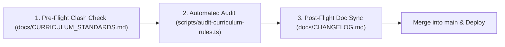

# 🛡️ 2lingo Change Governance & Pre-Merge Protocol

> **Mandatory Policy:** Every pull request, direct commit, curriculum batch, or database script **MUST** be verified against the standards in `docs/` before merging into `main`.

---

## 🚦 The Pre-Merge Protocol

Before executing any code changes or database seeds, the author (developer or AI assistant) must execute this 3-step cycle:

---

## 📋 The Pre-Merge Checklist

Every change must satisfy all items on this checklist:

### 1. Pedagogical Integrity ([`docs/CURRICULUM_STANDARDS.md`](./CURRICULUM_STANDARDS.md))
- [ ] **Deductive Elimination:** When introducing a net-new word without pictures, are all 3 distractor options words the child has **already mastered** in previous units? (No blind guessing).
- [ ] **Progressive Fading:** Are images restricted to Lesson 1 (Discovery)? Are Lessons 2, 3, and 4 (Boss Quest) 100% text + audio only?
- [ ] **Grid Symmetry:** Does every multiple-choice challenge have **exactly 4 options** in a balanced 2×2 grid?
- [ ] **Zero Punctuation Giveaways:** Single-word noun cards have zero trailing punctuation. Sentence options share identical syntax and punctuation across all 4 choices.

### 2. Asset & Infrastructure Integrity ([`docs/ARCHITECTURE.md`](./ARCHITECTURE.md))
- [ ] **Audio Playback:** Every option has a verified Azure neural `.mp3` file on disk under `public/audio/hr/`.
- [ ] **Vector Visuals:** Every option with `image_src` has a verified `.svg` file on disk under `public/`.
- [ ] **User Progress Guard:** No script or migration may wipe active user XP, hearts, or challenge completions (`Silvia`, `Adriana`, `Vanessa`).

### 3. Gamification & Privacy ([`docs/HEARTS_AND_GAMIFICATION.md`](./HEARTS_AND_GAMIFICATION.md))
- [ ] **Leaderboard Filter:** Test and admin accounts (e.g. `phil`, `J`) are strictly filtered out of the leaderboard; only legitimate child learners are displayed.
- [ ] **Heart Accountability:** All errors increment `hearts_used` to track learner accuracy.

### 4. Post-Flight Sync
- [ ] **Changelog Updated:** Every feature, unit addition, or schema change is documented in [`docs/CHANGELOG.md`](./CHANGELOG.md).
- [ ] **Standards Updated:** If a pedagogical rule evolved during the work, the corresponding document in `docs/` is updated immediately.
