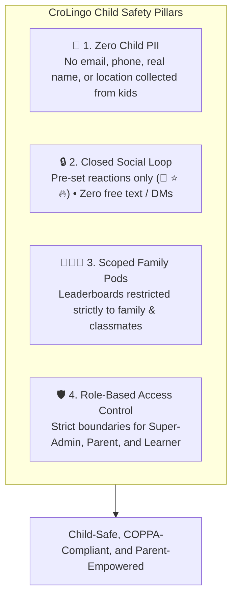

# 🛡️ CroLingo Child Privacy, Safety & COPPA / GDPR-K Compliance Standards

> **Document Status:** 🏛️ **CORE PRIVACY & SAFETY SPECIFICATION**  
> **Repository:** `AdminPhil/2lingo`  
> **Target Audience:** Young Learners (Ages 5–14+), Parents, Educators, Security Auditors, and Engineers  
> **Regulatory Foundations:** US COPPA (15 U.S.C. §§ 6501–6506), EU GDPR-K (Regulation (EU) 2016/679 Art. 8), and Croatian Personal Data Protection Laws  
> **Engineering Specifications:** See [`docs/ARCHITECTURE.md`](file:///c:/Users/phili/Documents/phils_repo/docs/ARCHITECTURE.md).

---

## 1. Executive Privacy Philosophy: "Safety by Architectural Design"

CroLingo is built from the ground up to be a safe, wholesome sanctuary where children and diaspora families can celebrate and learn the Croatian language without exposure to predatory advertising, data tracking, or internet strangers.

Our compliance philosophy follows **Privacy by Design**: rather than relying on complex terms of service or post-hoc moderation, **our architecture makes privacy violations and child data exposure structurally impossible**:



---

## 2. Core Pillar 1: Zero Child Personally Identifiable Information (No Child PII)

### 2.1 Email-Less & Phone-Less Child Accounts
Under COPPA and GDPR-K, collecting online contact information (such as an email address or mobile phone number) from a child under 13 requires verified parental consent.

CroLingo eliminates this risk entirely:
1. **Children NEVER provide an email address, phone number, full legal name, physical address, or date of birth.**
2. Child accounts are created exclusively by authorized parents or teachers through the **Direct Child Account Provisioning Engine** ([`actions/child-account.ts`](file:///c:/Users/phili/Documents/phils_repo/actions/child-account.ts)).
3. The parent assigns a simple child-friendly username (e.g. `marko_rijeka`, `luka_split`) and a password, written on an index card for their iPad or tablet.
4. Accounts are provisioned directly through the **Clerk Backend API** with zero email verification requirement.
5. All child accounts are permanently tethered to an authorized parent's Family Pod.

### 2.2 Zero Advertising, Tracking Beacons, or Data Broker Selling
- **No Behavioral Ads:** CroLingo displays zero third-party banner ads, popups, or sponsored marketing.
- **No Third-Party Analytics Trackers:** No Facebook Pixel, Google AdSense, TikTok pixels, or data broker analytics scripts are included in the codebase.
- **No Data Selling:** Learner data is never sold, leased, rented, or monetized to any external organization.

---

## 3. Core Pillar 2: Closed-Loop Social Architecture

Traditional social features (open chat rooms, direct messaging, profile comment walls) represent the single greatest safety risk on digital platforms for children.

CroLingo enforces a **100% Closed-Loop Social Architecture**:

```mermaid
flowchart LR
    LearnerA["Learner A (e.g. Silvia)"] -->|Taps 'High-Five 👋'| Server["Social Cheer Engine (actions/cheer.ts)"]
    Server -->|Validates Rate Limit (1/day)| DB[(pod_reactions Table)]
    DB -->|Displays Pre-Set Toast| LearnerB["Learner B (e.g. Adriana)"]
    LearnerB -->|Claims +5 XP| PodMeter["Shared Family Pod Celebration Meter"]
```

### 3.1 Pre-Set Canned Reactions Only
- Peer interaction is strictly restricted to **canned positive micro-interactions**:
  - `high_five` (👋 High-Five!)
  - `star` (⭐ Super Zvijezda!)
  - `flame` (🔥 Čuvaj Plamen!)
- **Zero Free-Form Text:** There is no text chat box, comment field, or direct messaging interface anywhere on the student learning path.
- **Zero Media Sharing:** Children cannot upload photos, voice recordings, videos, or external web links.

### 3.2 Built-In Anti-Spam Rate Limiting
- A learner can send **at most one cheer per recipient per calendar day**.
- Exchanging high-fives reinforces family bonds, awards a tiny mutual XP incentive (+5 XP), and pools points toward the weekly celebration meter without creating notification spam.

### 3.3 No Public Profile Pages
- Learners have no public URL, public biography, follower counts, or vanity metrics.
- Learner profiles exist only as visual stepping stones and row items within their authenticated Family Pod.

---

## 4. Core Pillar 3: Scoped Pod-Only Leaderboards & Privacy Boundaries

### 4.1 Relational Scoping (Zero Stranger Contact)
In traditional Duolingo-style leagues, children are pitted against random global internet strangers in public competitive tiers.

In CroLingo:
1. **Leaderboards are strictly scoped to the child's active Family or Classroom Pod** via [`db/queries.ts`](file:///c:/Users/phili/Documents/phils_repo/db/queries.ts) (`getTopTenUsers`).
2. Children only ever see family members, cousins, or classmates whose parents have shared the private 6-letter invite code.
3. Global internet users are completely invisible, and public user directories do not exist.
4. Adult administrators, developers, and test accounts (`phil`, `J`) are excluded from student pod leaderboards by design.

### 4.2 Secure Family Invite Codes
- Family Pods generate unique, unguessable 6-letter alphanumeric codes (e.g., `B9SHUF`, excluding confusing characters `O`, `0`, `I`, `1`).
- The invite code is owned and controlled exclusively by the parent or teacher organizer.
- A child cannot join a pod without parental initiation.

---

## 5. Core Pillar 4: Role-Based Access Control (RBAC)

CroLingo enforces strict permission boundaries between administrative users, parents, and student learners:

| Permission / Capability | `super_admin` | `parent` | `learner` | `unassigned` |
| :--- | :---: | :---: | :---: | :---: |
| **Complete Learning Path Quests (`/learn`)** | ✅ Yes | ✅ Yes | ✅ Yes | ❌ Gated |
| **Access Parent & Educator Center (`/admin`)** | ✅ Yes | ✅ Yes | ❌ Forbidden | ❌ Forbidden |
| **Manage & Inspect All System Pods** | ✅ Yes | ❌ (Own pods only) | ❌ Forbidden | ❌ Forbidden |
| **Provision Child Accounts (`AddChildModal`)** | ✅ Yes | ✅ Yes | ❌ Forbidden | ❌ Forbidden |
| **Trigger Parent Magic Wand Overrides** | ✅ Yes | ✅ Yes | ❌ Forbidden | ❌ Forbidden |
| **View Tricky Words Error Analytics** | ✅ Yes | ✅ Yes | ❌ Forbidden | ❌ Forbidden |
| **Send Peer High-Fives (`actions/cheer.ts`)** | ✅ Yes | ✅ Yes | ✅ Yes | ❌ Gated |
| **Manage Billing & Subscriptions** | ✅ Yes | ✅ Yes | ❌ Forbidden | ❌ Forbidden |

### Enforcement Mechanisms:
- **Server Actions:** Every administrative action (`adminRefillHearts`, `adminProtectStreak`, `adminAwardPraiseXp`, `createChildAccount`) validates that the caller is an authenticated parent owning the targeted pod or a verified Super-Admin ([`lib/admin.ts`](file:///c:/Users/phili/Documents/phils_repo/lib/admin.ts) → `isAdmin()`).
- **Route Middleware:** Next.js middleware and layout guards prevent learners from loading administrative dashboards.

---

## 6. Parental Rights, Consent & Data Erasure

CroLingo respects full parental autonomy over family data:

### 6.1 The Right to Review
Parents can inspect their children's complete learning records at any time directly through the Parent Center (`/admin`):
- Total XP earned and lesson progress.
- Current hearts and precision error tracking (`hearts_used`).
- Tricky words report (reviewing specific missed challenges and grammatical concepts).

### 6.2 The Right to Erasure ("Right to be Forgotten")
- Parents have the absolute right to delete any child account and purge all associated learning records (`user_progress`, `challenge_progress`, `challenge_mistakes`, and pod memberships).
- Upon deletion, the child's records are cascade-deleted from Neon PostgreSQL, and their session is revoked in Clerk immediately.

### 6.3 Minimal Data Retention Policy
- CroLingo collects and retains the bare minimum data required to facilitate language education:
  - Challenge completions to mark progress along the 4 Worlds map.
  - Accuracy mistakes to highlight tricky words for parents and power review quizzes.
  - Streak timestamps (`YYYY-MM-DD`) to encourage daily habit formation.

---

## 7. Compliance Verification Checklist for Contributors

Before releasing any new feature, pull request, or database script, verify:
- [ ] **No New Input Fields:** Does the feature avoid collecting children's personal contact info, phone numbers, or emails?
- [ ] **Closed Social Integrity:** Does the feature maintain canned-only reactions with zero free-text chat?
- [ ] **Pod Privacy Scoping:** Are all new queries scoped strictly to the user's active `pod_id`?
- [ ] **RBAC Verification:** Are administrative actions protected by `isAdmin()` or pod ownership checks?
- [ ] **Audit Script Green:** Does `npx tsx scripts/audit-curriculum-rules.ts` pass with 0 violations?
