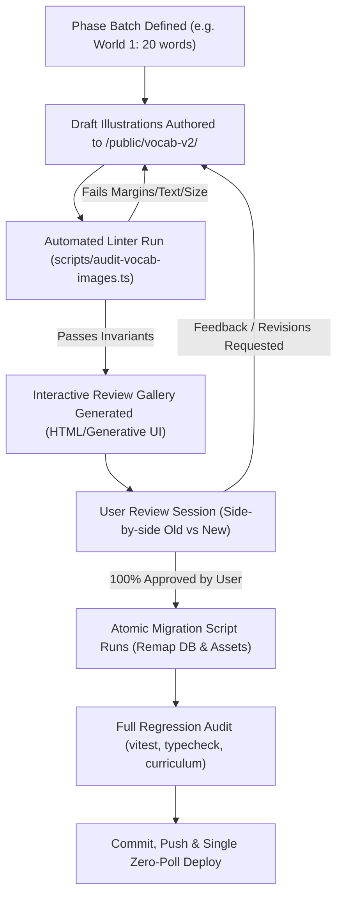

# Master Plan: Modernizing CroLingo Vocabulary Artwork

## 1. Executive Summary & Context

CroLingo's vocabulary challenges currently use ~125 vector SVGs and icons across Units 1–30 (Level 1 and Level 2). While functional, many were created piecemeal across different sprints, resulting in varying visual aesthetics, inconsistent stroke weights, and occasional semantic ambiguities (such as the chair-like table in BUG-038).

Replacing these assets is a high-value aesthetic upgrade, but it carries real risk if executed without strict guardrails. The avatar migration required five successive bug tickets (BUG-018 through BUG-022) to resolve circular crop clipping (Matija's jawline), headwear cuts (Luka's cap), text baked into illustration pixels (Roko & Delfi name strips), and inconsistent visual weights.

This plan establishes a **safe, staged, human-in-the-loop pipeline** designed specifically to prevent those mistakes. Production code will not be touched until you have personally reviewed and approved every new asset in an interactive side-by-side gallery.

---

## 2. Root Cause Post-Mortem: Why the Avatar Migration Was Painful

To ensure we do not repeat past frustrations, here is a direct analysis of what went wrong with the avatars and how this plan eliminates each risk:

```
┌──────────────────────────────────────────────┬────────────────────────────────────────────────────────┐
│ Past Avatar Pain Point                      │ Vocabulary Plan Counter-Measure                        │
├──────────────────────────────────────────────┼────────────────────────────────────────────────────────┤
│ 1. Direct-to-production changes              │ Parallel shadow directory (`/public/vocab-v2/`).       │
│    (User had to find issues in live app)     │ Zero production code or DB changes until approved.     │
├──────────────────────────────────────────────┼────────────────────────────────────────────────────────┤
│ 2. Text baked into illustrations             │ Strict SVG linter forbids `<text>` tags and baked      │
│    (Roko & Delfi subtitles, BUG-021/BUG-022) │ bitmap characters; pure iconography only.              │
├──────────────────────────────────────────────┼────────────────────────────────────────────────────────┤
│ 3. Inconsistent framing & clipping           │ Unified 1:1 master canvas (512×512) with mandatory     │
│    (Matija's chin, Luka's cap, BUG-018/020)  │ 10% safe-zone margin. No element touches borders.      │
├──────────────────────────────────────────────┼────────────────────────────────────────────────────────┤
│ 4. "All-at-once" blast radius                │ Phased, World-by-World batches (~20 words per batch)   │
│    (Cognitive fatigue reviewing 9 at once)   │ aligned with the existing 5-unit curriculum cadence.  │
├──────────────────────────────────────────────┼────────────────────────────────────────────────────────┤
│ 5. Ambiguous visual metaphors                │ Pre-generation semantic brief specifying child-first   │
│    (Table looking like a chair, BUG-038)     │ visual cues (e.g. tea has steam + tea bag tag).       │
└──────────────────────────────────────────────┴────────────────────────────────────────────────────────┘
```

---

## 3. The 6 Invariant Rules for Vocabulary Images

Every new vocabulary illustration must pass these six non-negotiable standards:

1. **Authentic Croatian Cultural Grounding (Anti-Generic Clip-Art):**
   - Wherever an object has an authentic Croatian regional design, culinary form, architectural tradition, or cultural motif, the artwork must draw from **real Croatian heritage** rather than generic Anglo/American stock iconography:
     - **Food & Bread:** `Kruh` must depict a rustic crusty round loaf (*domaći seljački kruh*) or corn bread (*kukuruzni kruh*), never sliced sandwich toast. `Sir` depicts a wheel/wedge of Paški cheese with salt-cured rind. `Kolač` depicts a traditional Croatian festive slice (*makovnjača*, *štrudla*, or *mađarica*), never a frosted American cupcake. `Burek` is rolled spiral pastry (*zvrk*), not a generic croissant.
     - **Architecture & Scenery:** `Kuća` features Mediterranean stone walls with red terracotta curved barrel tiles (*kupa kanalica*) or Slavonian wooden eaves, never suburban tract housing. `Prozor` features traditional wooden shutters (*škure / grilje*). `Most` features authentic stone arches (like Osijek, Drava, or Krka stone bridges). `Dvorac` reflects Trakošćan or Veliki Tabor turret silhouettes.
     - **Crafts & Heritage Objects:** `Srce` depicts an authentic red Licitar heart with white sugar scrollwork and mirror center. `Igračka` depicts the UNESCO-listed Zagorje painted wooden toy horse (*drveni konjić*). `Čamac` reflects a traditional wooden river boat (*dunavski čamac*) or coastal *batana*. `Brod / Trajekt` mirrors the classic Jadrolinija blue-and-white coastal ferry.
     - **Apparel & Tradition:** `Kapa` and `Nošnja` incorporate regional folk embroidery and heritage headwear (e.g. *Lička kapa* or *Šestinski šešir*).
2. **Unified Art Direction ("CroLingo Storybook Modern"):**
   - Soft, playful, modern vector aesthetic aligned with Paško the Dalmatian.
   - Clean continuous outlines (3–4px relative stroke), friendly vibrant palette, soft rounded corners.
   - Transparent background (zero white bounding boxes).
   - Zero photorealism; no AI uncanny valley artifacts.
3. **Strict Safe-Zone Geometry (The Anti-Clipping Rule):**
   - Master canvas: `512 × 512` viewBox (`0 0 512 512`).
   - Active graphic content must stay strictly within the **safe zone** (`48px` to `464px`), guaranteeing a 10% clear buffer on all four edges.
   - Preserves perfect optical centering when scaled down to `36×36`, `48×48`, or `80×80` in challenge cards.
4. **Zero Baked-In Text or Numbers:**
   - No Croatian words, English words, or labels inside the graphic. The language text is always rendered dynamically by the React component.
5. **Child-Centric Semantic Clarity:**
   - A 6-year-old child must identify the object in < 500ms without reading the prompt.
   - *Example:* `Čaj` (Tea) must show a steaming teacup with a hanging tea-bag tag, so it cannot be mistaken for coffee or hot chocolate.
   - *Example:* `Stol` (Table) must feature four clear legs and a wooden surface, avoiding any chair backrests.
6. **Format & Performance Standard:**
   - SVG vector format (or high-DPI crisp PNG fallback if complex gradients are used).
   - Target SVG file size < 12 KB per icon for instant loading across mobile devices.

---

## 4. The Interactive Review & Approval Pipeline

Rather than pushing files to git and asking you to test inside the live app, we will use a **dedicated local Visual Review Gallery**:



### The Visual Review Gallery UI
The gallery will be an interactive, standalone HTML artifact or local dashboard featuring:
* **Side-by-side comparison:** Old asset vs. New proposed asset.
* **Multi-scale rendering preview:** Shows each icon rendered at:
  * `36 × 36` (Learning path map / scenery scale)
  * `64 × 64` (Standard Lesson 1 SELECT challenge card)
  * `128 × 128` (Full resolution detail view)
* **Background toggle:** Check contrast on Light (`#FFFFFF`), Soft Slate (`#F8FAFC`), and Dark (`#0F172A`) backgrounds.
* **Croatian Cultural Fidelity Tag:** Confirms authentic cultural grounding (e.g. *Rustic peasant loaf*, *Paški sir wedge*, *UNESCO Zagorje toy*, *Dalmatian stone walls*).
* **Metadata display:** Target Croatian word, English translation, Unit ID, and lesson frequency.
* **One-click status toggles:** `[ ✅ Approved ]` or `[ 🔄 Revise: notes ]`.

---

## 5. Phased Rollout Schedule (Batches of ~20 Words)

Dividing the ~125 words into six manageable, theme-based phases ensures zero fatigue and maintains high quality:

| Phase | Theme & Units | Target Word Count | Key Vocabulary Examples |
| :--- | :--- | :---: | :--- |
| **Phase 1** | **World 1: The Hearth & Family** (Units 1–5) | 20 words | `Jabuka`, `Kruh`, `Voda`, `Mlijeko`, `Pas`, `Mačka`, `Kuća`, `Auto`, `Sunce` |
| **Phase 2** | **World 2: Zagreb Streets & School** (Units 6–10) | 20 words | `Knjiga`, `Škola`, `Razred`, `Olovka`, `Torba`, `Park`, `Vrata`, `Prozor` |
| **Phase 3** | **World 3: Nature, Forest & Sea** (Units 11–15) | 20 words | `Rijeka`, `Planina`, `More`, `Otok`, `Drvo`, `Oblak`, `Riba`, `Galeb` |
| **Phase 4** | **World 4: Dalmatian Coast** (Units 16–20) | 20 words | `Brod`, `Trajekt`, `Plaža`, `Kamen`, `Čaša`, `Tanjur`, `Nož`, `Vilica` |
| **Phase 5** | **World 5: Istra & Kvarner** (Units 21–25) | 20 words | `Sladoled`, `Arena`, `Delfin`, `Bicikl`, `Sat`, `Kapa`, `Cipele`, `Majica` |
| **Phase 6** | **World 6: Slavonian Hearth** (Units 26–30) | 20 words | `Kukuruz`, `Bundeva`, `Med`, `Pšenica`, `Orao`, `Čaplja`, `Vepar`, `Kolač`, `Čaj` |

---

## 7. Recommended Next Steps

1. **Review this Plan:** Confirm whether the 6-phase batching strategy and 5 golden rules match your vision.
2. **Build the Safe Infrastructure First:**
   - Author `scripts/audit-vocab-images.ts` (the automated linter).
   - Create the interactive **Review Gallery Tool**.
3. **Execute Phase 1 (World 1: Units 1–5, 20 words):**
   - Draft the 20 new icons in `/public/vocab-v2/`.
   - Open the Review Gallery for your review and approval before touching any database records or production paths.
